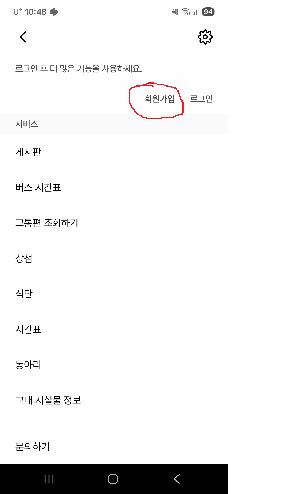

# 1-2 회원가입진입(클릭) - 레거시

원문 페이지 ID: e010221954bc8352bea4010b08266e6e

> 원문 스냅샷. 명세 확정·앱 배포·수집 완료를 뜻하지 않습니다.

## 원문 속성

```json
{
  "platform": [
    "ANDROID",
    "IOS",
    "WEB"
  ],
  "url": "source-page-id:e010221954bc8352bea4010b08266e6e",
  "구분": "회원가입진입",
  "상태": "로깅 필요",
  "생성일": "2026-11-12T05:07:33.134Z",
  "이벤트 이름": "1-2 회원가입진입(클릭) - 레거시",
  "태그": [
    "회원가입"
  ]
}
```

<details>
<summary>과거 로깅</summary>

- event\_label : “hamburger”
- value : “회원가입 시작<b>”</b>
- event\_category : “click”
- custom\_session\_id : \{sign\_up\}\_\{0\}\_\{플랫폼\}\_\{세션시작시간\}\_\{랜덤값\}


</details>


