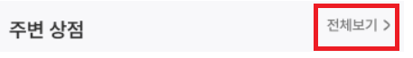
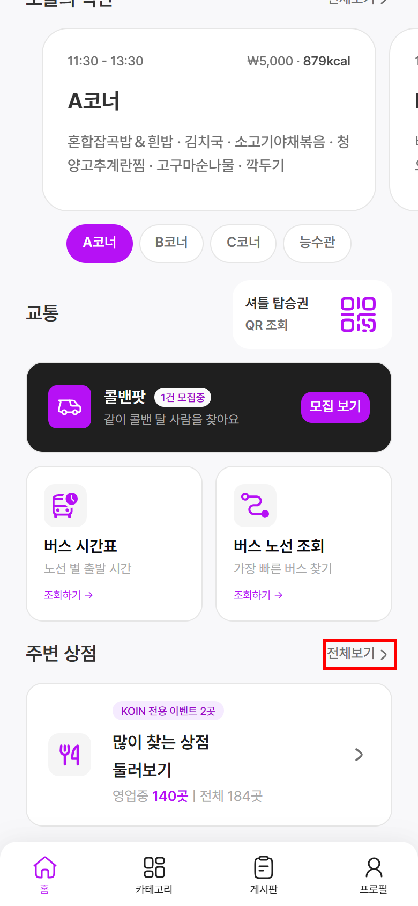

# 1-9 주변 상점 전체보기 클릭

원문 페이지 ID: e030221954bc8389a5918184171d55af

> 원문 스냅샷. 명세 확정·앱 배포·수집 완료를 뜻하지 않습니다.

## 원문 속성

```json
{
  "platform": [
    "ANDROID",
    "IOS",
    "WEB"
  ],
  "url": "source-page-id:e030221954bc8389a5918184171d55af",
  "구분": "홈화면",
  "상태": "완료",
  "생성일": "2026-11-12T05:08:01.383Z",
  "이벤트 이름": "1-9 주변 상점 전체보기 클릭"
}
```

<details>
<summary>과거 로깅</summary>

- event\_label : shop
- value : 전체보기
- event\_category : click





</details>

<details>
<summary>새 로깅</summary>

- 설명: 기존 모바일 홈의 주변 상점 전체보기 버튼을 눌러 상점 목록으로 진입할 때 기록한다. 개별 상점 카테고리 선택·많이 찾는 상점 카드는 포함하지 않는다. WEB 리디자인에서는 별도 전체보기 버튼이 미확인이므로 인기 상점 카드에 이 라벨을 적용하지 않는다.
- screen\_view: <code>main</code>
- event\_name: <code>DA2</code>
- event\_label: <code>main__main__shop_entry__main_entry__click</code>
- value: 주변상점
- event\_category: <code>click</code>

### 참고사진 (메인 → 주변상점 클릭)

<b>웹</b>

<b>참고사진 · 웹</b>

현재 WEB 리디자인에서 별도 ‘주변 상점 전체보기’ 버튼은 확인되지 않았다. 현행 클릭 사진 없음. ‘많이 찾는 상점 둘러보기’ 카드는 [1-10 많이 찾는 상점 둘러보기 클릭](30a0221954bc8297844901591055351f.md)의 별도 동작이므로 이 명세의 사진으로 대신 사용하지 않는다.

<b>모바일</b>

<b>참고사진 · 모바일</b>

모바일 — 메인 → 주변상점 클릭 (출처: stage 실제 캡처, 빨간 네모 = 클릭 위치)


</details>
