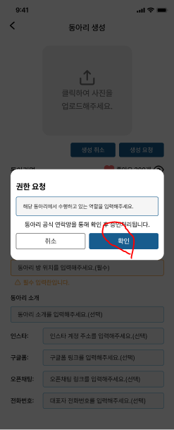
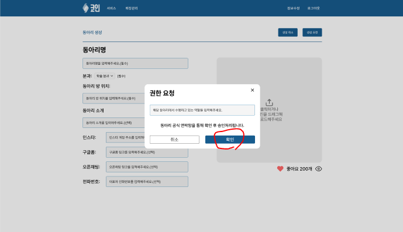

# 3-4. 동아리_동아리 권한요청

원문 페이지 ID: e050221954bc826085400158206a329f

> 사용자 제공 ZIP 내보내기 보관본. 레거시·동결·검토 상태는 원문을 따르며 코드 생성 승인·앱 배포 완료를 뜻하지 않습니다.

platform: ANDROID, IOS, WEB
상태: 완료

- 설명: 동아리 생성 화면의 권한요청 팝업에서 확인 클릭
- event_name : “CAMPUS”
- event_label : “club_create_request_authority”
- value : 텍스트 박스 내의 값
- event_category : “click”
- 참고사진

- 웹 참고사진

