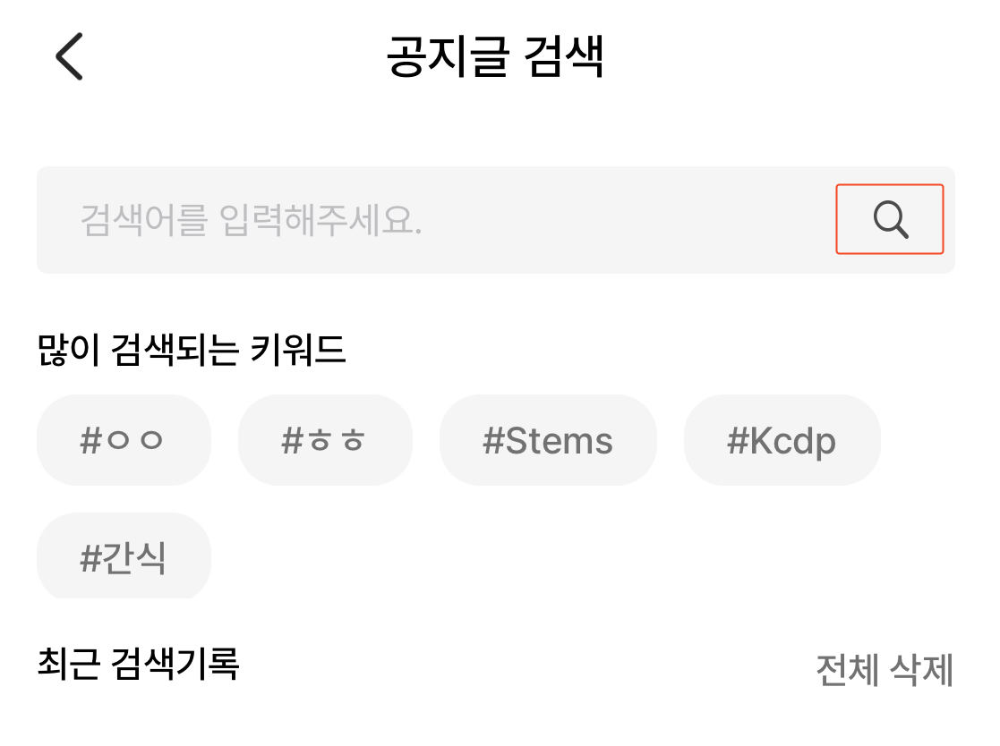

# 6-4. 공지글 검색_검색하기_클릭

원문 페이지 ID: e070221954bc8233817181646b5e6df1

> 누락 원본 복구 스냅샷. 원본의 과거값·검토 기록을 보존하며 생성 계약으로 자동 승인하지 않습니다.

대조 기록: [87개 원본 복구 및 8개 차이 정리](../recovery-review.md)

관련 기존 보관본: [6-3. 공지글 검색_검색하기_클릭](82b0221954bc8273abbe81b4fc39095e.md), [6-3. 공지글 검색_검색하기_클릭](9ee0221954bc8247badd01d88c248db9.md)

## 원문 속성

```json
{
  "platform": [
    "ANDROID",
    "IOS"
  ],
  "url": "source-page-id:e070221954bc8233817181646b5e6df1",
  "상태": "완료",
  "이름": "6-4. 공지글 검색\\_검색하기\\_클릭"
}
```

<ul>
<li>
설명 : 공지글 검색 페이지에서 <u>최종 검색 버튼 클릭</u>
</li>
<li>

주의사항
 : Enter, 돋보기 버튼 모두 로깅
</li>
<li>
event\_label : “notice\_search\_event”
</li>
<li>
value : “검색하기<b>”</b>
</li>
<li>
event\_category : “click” 
</li>
<li>
참고사진





</li>
</ul>
