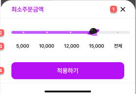

# 2-14 상점 카테고리 최소주문금액 설정

원문 페이지 ID: e190221954bc8267885601807a7a4dd5

> 원문 스냅샷. 명세 확정·앱 배포·수집 완료를 뜻하지 않습니다.

## 원문 속성

```json
{
  "platform": [
    "ANDROID",
    "IOS"
  ],
  "url": "source-page-id:e190221954bc8267885601807a7a4dd5",
  "상태": "로깅 필요",
  "생성일": "2026-11-12T05:07:44.589Z",
  "이벤트 이름": "2-14 상점 카테고리 최소주문금액 설정",
  "태그": [
    "2. 상점 카테고리"
  ]
}
```




금액을 설정하고 적용하기를 눌렀을 때 발생하는 로깅


<span color="orange">event\_params.key</span>

<ul>
<li>
event\_label : min\_amount\_set
</li>
<li>
value : 금액
</li>
<li>
event\_category : click 
</li>
</ul>


