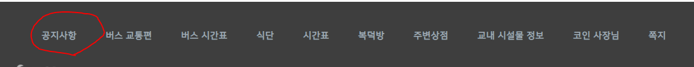

# 2-2. 푸터_공지사항_클릭

원문 페이지 ID: e280221954bc833ba2d5010881c890de

> 원문 스냅샷. 명세 확정·앱 배포·수집 완료를 뜻하지 않습니다.

## 원문 속성

```json
{
  "platform": [
    "WEB"
  ],
  "url": "source-page-id:e280221954bc833ba2d5010881c890de",
  "상태": "로깅 필요",
  "이름": "2-2. 푸터\\_공지사항\\_클릭",
  "태그": [
    "2. 헤더/푸터/햄버거_공지사항"
  ]
}
```

<details>
<summary>과거 로깅</summary>

- 설명: 푸터 에서 공지사항 클릭
- event\_label : “footer”
- value : “공지사항”
- event\_category : “click”
- 참고사진



</details>

<details>
<summary>새 로깅</summary>

- 설명: 웹 푸터의 공지사항 메뉴 클릭.
- screen\_view: <code>footer</code>
- event\_name: <code>DA2</code>
- event\_label: <code>board__footer__notice_entry__footer_entry__click</code>
- value: 공지사항
- event\_category: <code>click</code>

### 참고사진 (WEB 리디자인 · 푸터 공지사항)

<b>웹</b>

<b>참고사진 · 웹</b>

[Figma 원본](https://www.figma.com/design/DPlcYuiFxhyT5ULbqec59i/KOIN-Web?node-id=17664-28870) · 2026-11-04. 원본 캡처에 빨간 네모만 추가했다. 빨간 네모는 기존 명세의 공지사항 클릭 위치다. 실제 SDK 적용·배포·전송은 미확인이다.


</details>
