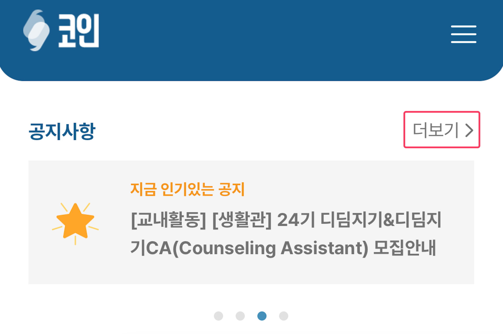

# 8-1. 더보기_클릭

원문 페이지 ID: e2e0221954bc839b917881b69ef3a9e8

> 원문 스냅샷. 명세 확정·앱 배포·수집 완료를 뜻하지 않습니다.

## 원문 속성

```json
{
  "platform": [
    "ANDROID",
    "IOS"
  ],
  "url": "source-page-id:e2e0221954bc839b917881b69ef3a9e8",
  "상태": "레거시",
  "이름": "8-1. 더보기\\_클릭",
  "태그": [
    "8. 앱 메인(APP)"
  ]
}
```

<details>
<summary>이전 로깅</summary>

<ul>
<li>
event\_label : “app\_main\_notice\_detail”
</li>
<li>
value : “더보기<b>”</b>
</li>
<li>
event\_category : “click” 
</li>
<li>
참고사진


</li>
</ul>


</details>

<details>
<summary>새 로깅 (26.10.05) — 초안</summary>

- 설명: 앱 메인 화면의 공지사항 더보기 클릭.
- screen\_view:
- event\_name: <code>DA1</code>
- event\_label: <code>board__main__notice__more_click</code>
- value: “공지사항 더보기”
- event\_category: <code>click</code>
- 적용 플랫폼: ANDROID, IOS
- 참고사항
  - WEB의 1-1과 같은 행동이므로 event\_label과 value를 공유하고 platform으로 구분합니다.
- 참고사진: 이전 로깅의 참고사진 참조
</details>

레거시 사유 : 리디자인으로 공지사항 더보기가 없어짐
