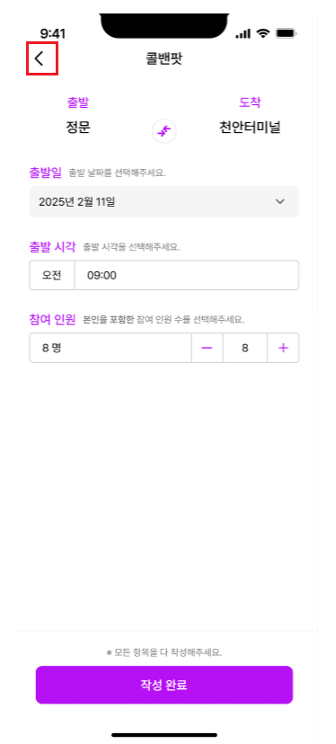
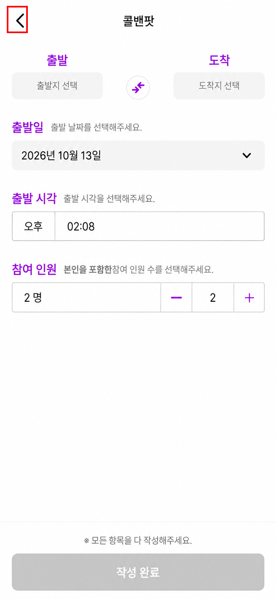

# 3-5 콜밴팟 모집 이탈

원문 페이지 ID: e2f0221954bc82d69e99017b64901266

> 원문 스냅샷. 명세 확정·앱 배포·수집 완료를 뜻하지 않습니다.

## 원문 속성

```json
{
  "platform": [
    "ANDROID",
    "IOS"
  ],
  "url": "source-page-id:e2f0221954bc82d69e99017b64901266",
  "상태": "로깅 필요",
  "이름": "3-5 콜밴팟 모집 이탈",
  "태그": [
    "3. 콜밴팟 모집"
  ]
}
```

<details>
<summary>이전 로깅</summary>


- event\_name : CAMPUS
- event\_category
  - click
  - swipe
- event\_label : callvan\_write\_back
- value :



</details>

<details>
<summary>새 로깅 (2026-10-14) — 초안</summary>

- 설명: 모집글 작성 화면에서 뒤로가기 클릭 또는 OS 스와이프로 이탈한다.
- screen\_view: <code>callvan_write</code>
- event\_label: <code>callvan__callvan_write__navigation__back__click</code>
- event\_name: <code>DA2</code>
- value: 기존 미기재 유지
- event\_category: <code>click</code>

<details>
<summary>검토사항</summary>

- label 통일 (2026-10-27): callvan\_\_callvan\_write\_\_navigation\_\_back → callvan\_\_callvan\_write\_\_navigation\_\_back\_\_click (event\_category가 click 또는 swipe라 모호하나 click으로 표기, 확인 필요)
- 후속 수정 (2026-10-27): event\_category <code>click 또는 swipe (실제 이탈 방식에 따라 기존 값 유지)</code> → <code>click</code> (label 마지막 단어 기준)
</details>

### 참고사진 (기능 표시)

<b>모바일 (ANDROID, IOS) / 캡처 출처는 아래 참조</b>

<details>
<summary>참고사진 · 모바일</summary>

화면 정의의 Android 실제 캡처(2026-10-13), 선명도 개선본. 이번 작업은 기존 캡처를 사용. 박스는 뒤로가기 클릭 대상.


</details>
</details>
