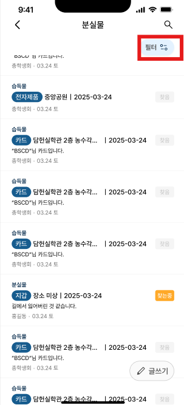
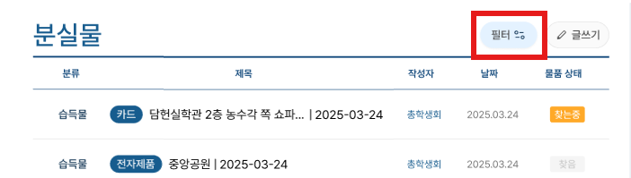
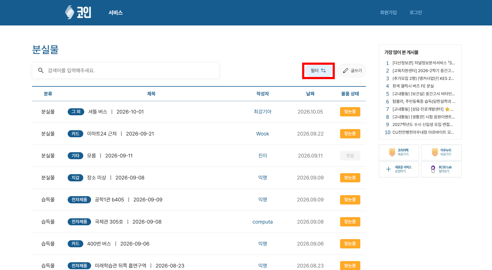
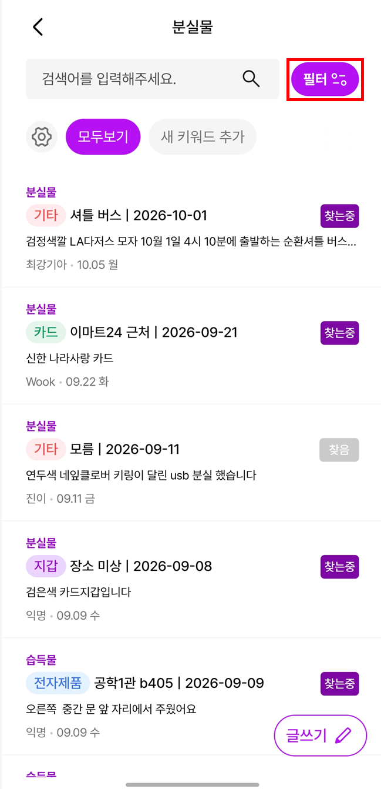

# 11-22. 분실물_필터_클릭

원문 페이지 ID: e3d0221954bc82b8a151813ce8f00019

> 원문 스냅샷. 명세 확정·앱 배포·수집 완료를 뜻하지 않습니다.

## 원문 속성

```json
{
  "platform": [
    "ANDROID",
    "IOS",
    "WEB"
  ],
  "url": "source-page-id:e3d0221954bc82b8a151813ce8f00019",
  "상태": "완료",
  "이름": "11-22. 분실물\\_필터\\_클릭",
  "태그": [
    "11.분실물"
  ]
}
```

<details>
<summary>과거 로깅</summary>

- 설명: 분실물 글 목록 페이지에서 필터 버튼 클릭
- event\_label : lost\_item\_filter
- value : 분실물
- event\_category : click
- 참고사진




</details>

<details>
<summary>새 로깅</summary>

- 설명: 분실물 글 목록 페이지에서 필터 버튼 클릭
- screen\_view: <code>lost_item_list</code>
- event\_name: <code>DA2</code>
- event\_label: <code>board__lost_item_list__filter__open__click</code>
- value: 분실물
- event\_category: <code>click</code>

### 참고사진 (기능 표시)

<columns>
<column ratio="50">
<b>웹</b>

<b>참고사진 · 웹</b>

웹 — 필터 열기


</column>
<column ratio="50">
<b>모바일</b>

<b>참고사진 · 모바일</b>

모바일 — 필터 열기


</column>
</columns>
</details>
