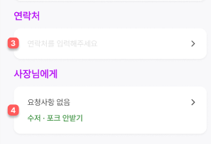
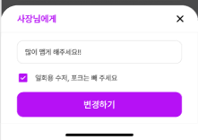

# 7-16 결제 페이지 가게 요청사항 설정

원문 페이지 ID: e410221954bc83dc932e81ac2696e5ee

> 원문 스냅샷. 명세 확정·앱 배포·수집 완료를 뜻하지 않습니다.

## 원문 속성

```json
{
  "platform": [
    "WEB"
  ],
  "url": "source-page-id:e410221954bc83dc932e81ac2696e5ee",
  "상태": "로깅 필요",
  "생성일": "2026-11-08T10:51:32.743Z",
  "이벤트 이름": "7-16 결제 페이지 가게 요청사항 설정",
  "태그": [
    "7. 결제 페이지"
  ]
}
```

<columns>
<column ratio="50">

</column>
<column ratio="50">

</column>
</columns>


4번 요청사항 클릭 후 오른쪽 시트가 올라옵니다


아래와 같이 사용자가 입력하는 요청사항과 체크박스 여부를 동시에 value에 넣을 수 있을까요?

문제가 있다면 연락 부탁드리겠습니다!


event\_params.key

<ul>
<li>
event\_label : payment\_owner\_note
</li>
<li>
value : 

- 요청사항, 체크박스O
- 요청사항, 체크박스X
</li>
<li>
event\_category :

- click
</li>
</ul>
