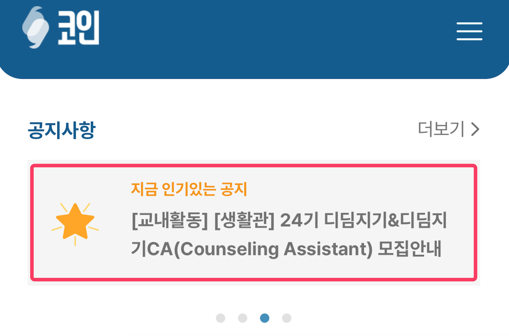

# 8-2. 지금 인기있는 공지 배너_클릭

원문 페이지 ID: e450221954bc82908813819138dad6c1

> 원문 스냅샷. 명세 확정·앱 배포·수집 완료를 뜻하지 않습니다.

## 원문 속성

```json
{
  "platform": [
    "ANDROID",
    "IOS"
  ],
  "url": "source-page-id:e450221954bc82908813819138dad6c1",
  "상태": "레거시",
  "이름": "8-2. 지금 인기있는 공지 배너\\_클릭",
  "태그": [
    "8. 앱 메인(APP)"
  ]
}
```

<details>
<summary>과거 로깅</summary>

<ul>
<li>
event\_label : “popular\_notice\_banne”
</li>
<li>
value : “\{공지명\}<b>”</b>
</li>
<li>
event\_category : “click” 
</li>
<li>
참고사진


</li>
</ul>
</details>

<details>
<summary>새 로깅</summary>

- 설명: 앱 메인 화면의 지금 인기있는 공지 배너 클릭.
- screen\_view:
- event\_name: <code>DA2</code>
- event\_label: <code>board__main__popular_notice__click</code>
- value: “\{공지명\}”
- event\_category: <code>click</code>
- 적용 플랫폼: ANDROID, IOS
- 참고사항
  - 클릭한 공지의 제목을 value로 전달합니다. 기존 popular\_notice\_banne 라벨을 새 네이밍으로 정리합니다.
- 참고사진: 이전 로깅의 참고사진 참조
</details>
