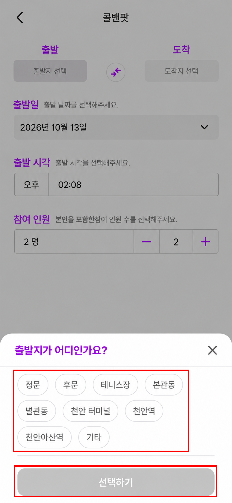

# 3-1 콜밴팟 출발지 선택

원문 페이지 ID: e640221954bc82429edd8117e763ab61

> 사용자 제공 ZIP 내보내기 보관본. 레거시·동결·검토 상태는 원문을 따르며 코드 생성 승인·앱 배포 완료를 뜻하지 않습니다.

태그: 3. 콜밴팟 모집
platform: ANDROID, IOS
상태: 로깅 필요

- 과거 로깅
    
    
    - event_name : CAMPUS
    - event_category : click
    - event_label : callvan_write_departure
    - value
        - 예시 : 교내, 정문
        - 예시 : 교외, 천안 터미널
        - 예시 : 교내, 기타, 인문경영관
    
    
    
- 새 로깅
    - 설명: 모집글 작성 화면 위 출발지 선택 바텀시트에서 장소를 선택하고 선택하기를 클릭한다.
    - screen_view: `callvan_write`
    - event_label: `callvan__callvan_write__callvan_write__departure_confirm__click`
    - event_name: `DA2`
    - value: - 예시 : 교내, 정문
    - 예시 : 교외, 천안 터미널
    - 예시 : 교내, 기타, 인문경영관
    - event_category: `click`
    - 발생 시점 확정: 출발지 선택 바텀시트의 ‘선택하기’ 버튼을 누르는 순간, 최종 선택한 출발지를 기존 value 형식으로 전송한다. 장소 항목을 고르는 중에는 이 이벤트를 전송하지 않는다. 2026-10-15 Android에서 출발지 선택 바텀시트와 하단 ‘선택하기’ 버튼을 실제 확인했다.
    
    ### 참고사진 (기능 표시)
    
    **모바일 (ANDROID, IOS) / 캡처 출처는 아래 참조**
    
    **참고사진 · 모바일**
    
    화면 정의의 Android 실제 캡처(2026-10-13), 선명도 개선본. 이번 작업은 기존 캡처를 사용. 추가 출발지 바텀시트 이미지.
    
    
