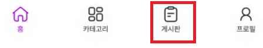
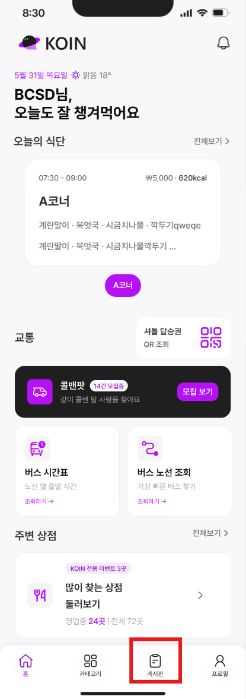

# 2-3 네비게이션 바 게시판 클릭

원문 페이지 ID: e720221954bc8366ab190191154be107

> 원문 스냅샷. 명세 확정·앱 배포·수집 완료를 뜻하지 않습니다.

## 원문 속성

```json
{
  "platform": [
    "ANDROID",
    "IOS",
    "WEB"
  ],
  "url": "source-page-id:e720221954bc8366ab190191154be107",
  "구분": "네비게이션 바",
  "상태": "완료",
  "생성일": "2026-11-08T10:52:04.020Z",
  "이벤트 이름": "2-3 네비게이션 바 게시판 클릭"
}
```

<callout icon="📌" color="blue_bg">
<b>현행 홈 로깅 기준 명세</b>

- 2026-11-04 사용자 결정으로 새 로깅을 이 페이지로 이관했다. 이전의 이 페이지 레거시 지정은 이 결정으로 대체한다.
- 이관 전 명세: [2-3. 공지사항_클릭 (레거시)](d300221954bc8330be2381687a8f27c1.md) — 레거시 보존.
- 현행 event\_label: <code>main__main__notice_entry__navigation_entry__click</code>. 아래 ‘새 로깅’을 구현·전달 기준으로 사용한다.
</callout>

<details>
<summary>이전 로깅 · 참조 및 레거시 지정 이력 (현재 결정으로 대체됨)</summary>

<callout icon="📁" color="gray_bg">
<b>레거시 명세 · 이력 보존</b>

- 사용자 결정: 2026-11-04. 이 페이지는 레거시로 보존하며 별도 새 로깅 구현·추가 전송의 기준으로 사용하지 않는다.
- 관련 현행 기준 명세: [2-3. 공지사항_클릭 (레거시)](d300221954bc8330be2381687a8f27c1.md).
- 기존 label·value·category·사진·플랫폼과 원문은 이력으로 유지한다. 기준 명세와의 value/category 차이가 모두 해소되었다는 뜻은 아니며, 이 문서 정리로 실제 SDK 수집 중단이나 중복 제거가 확인된 것은 아니다.
</callout>

- event\_label : nav\_bulletin
- value : 게시판
- event\_category : click





<details>
<summary>검토사항 · 중복·연관 명세 참조 (26.11.01)</summary>

- WEB 리디자인 반영 (2026-11-04 사용자 승인): WEB 리디자인 프레임에는 하단 게시판 탭이 없다. 이 하단 내비게이션 명세는 해당 WEB 리디자인 적용 대상에서 제외하고 모바일 참조는 유지한다. 홈 공지사항 행·전체보기·헤더 커뮤니티 메뉴에 하단 탭 라벨을 재사용하지 않는다.
- WEB 설계 근거: [Figma 참고 / 실제 화면 미확인](https://www.figma.com/design/DPlcYuiFxhyT5ULbqec59i/KOIN-Web?node-id=11541-33352). 기존 사진은 교체하지 않았으며 리디자인 화면의 위치 근거로 사용하지 않는다. SDK 구현·배포 시점·실제 수집은 미확인이다. 이 WEB 규정은 해당 화면의 과거 WEB 설명보다 우선하며 모바일·이전 로깅·기존 필드 값·DB 플랫폼 속성은 보존한다.
- 하단 네비게이션 게시판 클릭: 현행 관련 명세 [2-3. 공지사항_클릭 (레거시)](d300221954bc8330be2381687a8f27c1.md)를 참고한다.
- 같은 하단 게시판 진입을 설명하지만 홈 value 게시판과 기준 공지사항의 차이는 보존한다. 실제 UI·SDK 계약 확인 전 동일 계약으로 등록하지 않는다.
- 사용자 요청에 따라 중복·연관 항목에는 별도 새 event\_label을 추가하지 않는다. 기존 원문·CAMPUS 지시·value·category·사진·DB 플랫폼과 상태를 보존한다. 레거시 보존 여부는 위 최신 사용자 결정에 따른다. SDK 중복 발화 여부와 실제 수집 중단 시점은 미확인이다.
- 같은 클릭에 문서 수만큼 이벤트를 추가하지 않는다. 실제 호출·플랫폼별 적용과 단일 전송은 개발 확인 필요다.
</details>
</details>

<details>
<summary>새 로깅 (26.11.04)</summary>

- 설명: 앱 하단 네비게이션 바에서  공지사항(게시판) 항목 클릭.
- screen\_view: <code>main</code>
- event\_name: <code>DA2</code>
- event\_label: <code>main__main__notice_entry__navigation_entry__click</code>
- value: 공지사항
- event\_category: <code>click</code>

<details>
<summary>검토사항</summary>

- WEB 사진 기준 정리 (2026-11-04 사용자 지시): 새 로깅의 WEB 참고사진에는 리디자인 시안만 둔다. 구디자인 WEB 사진은 이전 로깅 이력으로 이동했다. 리디자인에서 버튼이 확인되지 않으면 사진 없이 미확인으로 표시한다. 라벨·value·category·event\_name·screen\_view·플랫폼과 모바일 사진은 유지한다.
- 현행 기준 이관 (2026-11-04 사용자 지시): [2-3. 공지사항_클릭 (레거시)](d300221954bc8330be2381687a8f27c1.md)의 새 로깅 본문·사진을 이 페이지로 이관했다. 원본 페이지는 레거시로 보존하며 현행 기준은 이 홈 페이지다.
- 첫 구간 변경 (2026-11-04 사용자 지시): <code>board__main__notice_entry__navigation_entry__click</code> → <code>main__main__notice_entry__navigation_entry__click</code>. service\_name만 <code>main</code>으로 바꾸고 screen\_view·기능/detail·event\_name·value·category·발생 시점은 이관 원본대로 유지한다. 이전 홈 원문의 다른 value/category는 이전 로깅 이력이며 새 계약에 섞지 않는다.
- 적용 플랫폼은 이관 원본의 ANDROID / IOS 범위다. DB 플랫폼 속성은 변경하지 않았다. 실제 SDK 적용·배포·한 번 전송과 신규 라벨 수집은 미확인이다.
- 아래 과거 검토 메모의 변경 이력·동일 라벨 설명은 이관 전 계약에 대한 기록이다. 현재 적용 라벨과 기준 위치는 위 최신 결정이 우선한다. 문서 이관은 이벤트를 추가로 전송하라는 뜻이 아니다.
- label 통일 (2026-10-27): <code>board__main__notice_entry__navigation_entry</code> → <code>board__main__notice_entry__navigation_entry__click</code>
</details>

### 참고사진 (하단 게시판 클릭)

<b>웹</b>

<details>
<summary>참고사진 · 웹</summary>

<b>리디자인 시안에서 미확인 — WEB 클릭 사진 없음</b>

리디자인 데스크톱 WEB에는 하단 게시판 탭이 확인되지 않는다. 이 명세는 이관 원본처럼 ANDROID·IOS 하단 내비게이션에 적용한다. 새 홈 공지사항 영역이나 헤더 커뮤니티 메뉴와 같은 이벤트로 간주하지 않는다.

[Figma 홈 리디자인](https://www.figma.com/design/DPlcYuiFxhyT5ULbqec59i/KOIN-Web?node-id=11541-33352)
</details>

<b>모바일</b>

<details>
<summary>참고사진 · 모바일</summary>

<b>모바일</b>


</details>


</details>
