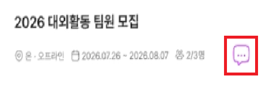
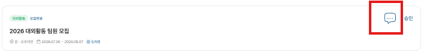

# 8-2. 채팅 클릭

원문 페이지 ID: e7f0221954bc82e2821381728739ff35

> 원문 스냅샷. 명세 확정·앱 배포·수집 완료를 뜻하지 않습니다.

## 원문 속성

```json
{
  "platform": [
    "WEB",
    "ANDROID",
    "IOS"
  ],
  "url": "source-page-id:e7f0221954bc82e2821381728739ff35",
  "구분": "내가 지원한 모집글",
  "상태": "로깅 필요",
  "생성일": "2026-11-08T10:52:14.896Z",
  "이벤트 이름": "8-2. 채팅 클릭"
}
```


<details>
<summary>이전 로깅</summary>

- event\_label : team\_recruitment\_applied\_post\_chat
- value : 사용자가 채팅을 선택한 모집글 이름
- event\_category : click




</details>

<details>
<summary>새 로깅 (26.10.17)</summary>

- 설명: 내가 지원한 모집글 화면에서 모집글 카드의 채팅 버튼을 클릭해 작성자와의 채팅방으로 들어가는 경우
- screen\_view: <code>team_applied</code>
- event\_name: <code>DA1</code>
- event\_label: <code>team_recruit__team_applied__chat_entry__entry__click</code>
- value: \{카테고리\}\_\{모집글 id\} (예: 스터디\_100)
- event\_category: <code>click</code>

<details>
<summary>검토사항</summary>

- 통합 가이드·후속: [로깅 통합 가이드](3c30221954bc8214b1c481c5bbb6fba5.md)
- 모집글 제목은 자유 텍스트라 카테고리와 모집글 id로 구분한다(과거 명세의 모집글 이름과 다름, 확인 필요).
- label DA2 기준 정렬 (2026-10-27): <code>team_recruit__team_applied__chat__click</code> → <code>team_recruit__team_applied__chat_entry__entry__click</code>
- 참고사진: 테스트 계정의 지원 내역이 거절 상태 1건뿐이라 카드에 채팅 버튼이 없어 캡처 못 함 (승인된 지원에만 보이는 것으로 추정)
</details>

### 참고사진 (채팅 클릭)

<columns>
<column ratio="50">
<b>웹</b>

<details>
<summary>참고사진 · 웹</summary>

웹 — 사진 없음 (추가 필요)
</details>
</column>
<column ratio="50">
<b>모바일</b>

<details>
<summary>참고사진 · 모바일</summary>

모바일 — 사진 없음 (추가 필요)
</details>
</column>
</columns>
</details>
