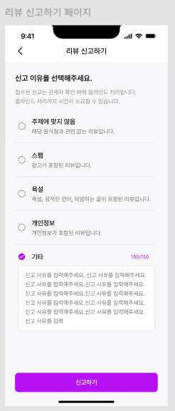

# 4-4 상점상세 리뷰 신고 (클릭) 

원문 페이지 ID: e850221954bc821c8ae90189190bf024

> 원문 스냅샷. 명세 확정·앱 배포·수집 완료를 뜻하지 않습니다.

## 원문 속성

```json
{
  "platform": [
    "ANDROID",
    "IOS",
    "WEB"
  ],
  "url": "source-page-id:e850221954bc821c8ae90189190bf024",
  "상태": "완료",
  "생성일": "2026-11-08T10:51:54.245Z",
  "이벤트 이름": "<p>\n4-4 상점상세 리뷰 신고 (클릭) \n</p>",
  "태그": [
    "4. 리뷰 페이지"
  ]
}
```




신고 페이지에 들어온 후 사유를 선택하고 신고하기 버튼 클릭 로깅입니다


<span color="orange">event\_params.key</span>

<ul>
<li>
event\_label : shop\_detail\_view\_review\_report
</li>
<li>
value 

- 주제에 맞지 않음
- 스팸
- 욕설
- 개인정보
- 기타 (문자열 값)
</li>
<li>
event\_category : click
</li>
</ul>


---


