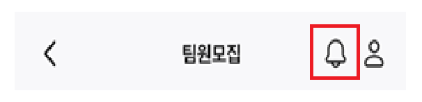
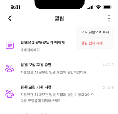
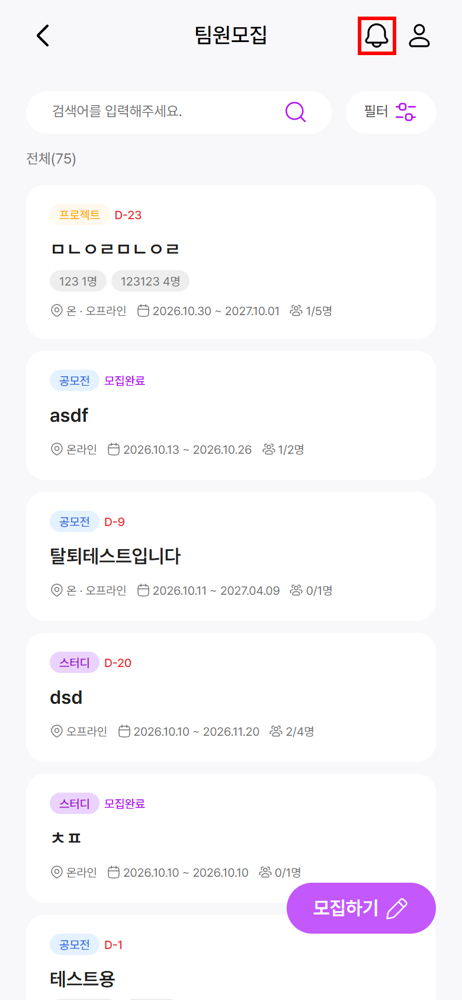

# 0. 알림 클릭

원문 페이지 ID: e890221954bc8253a8db815eb861b6e9

> 원문 스냅샷. 명세 확정·앱 배포·수집 완료를 뜻하지 않습니다.

## 원문 속성

```json
{
  "platform": [
    "ANDROID",
    "IOS"
  ],
  "url": "source-page-id:e890221954bc8253a8db815eb861b6e9",
  "구분": "알림",
  "상태": "로깅 필요",
  "생성일": "2026-11-08T10:52:07.309Z",
  "이벤트 이름": "0\\. 알림 클릭"
}
```

<details>
<summary>이전 로깅</summary>

팀은 전부 다 CAMPUS로 해주세요!!


- event\_label : team\_recruitment\_notification
- value : 알림
- event\_category : “click”




팀원 모집 관련 알림 클릭 시

[1-2 알림 클릭 내부](b070221954bc83b8a6ba81237e905425.md)


</details>

<details>
<summary>새 로깅 (26.10.17)</summary>

- 설명: 팀원 모집 목록 화면 상단의 알림(종) 아이콘을 클릭해 팀원 모집 알림 목록(/team/notifications)으로 들어가는 경우
- screen\_view: <code>team_list</code>
- event\_name: <code>DA1</code>
- event\_label: <code>team_recruit__team_list__team_notification__entry__click</code>
- value: 알림
- event\_category: <code>click</code>

<details>
<summary>검토사항</summary>

- 통합 가이드·후속: [로깅 통합 가이드](3c30221954bc8214b1c481c5bbb6fba5.md)
- 웹: 없음 (모바일 전용)
- label DA2 기준 정렬 (2026-10-27): <code>team_recruit__team_list__notification__click</code> → <code>team_recruit__team_list__team_notification__entry__click</code>
- 알림 목록 안에서 개별 알림을 누르는 로깅(1-2 알림 클릭 내부, 공용 notification\_list)은 main 서비스 공용 알림 로깅으로 따로 관리한다.
- 사진 플랫폼 확인 완료 (이미지 비율 기준: 모바일, 780x1688)
</details>

### 참고사진 (알림 클릭)

<columns>
<column ratio="50">
<b>웹</b>

<details>
<summary>참고사진 · 웹</summary>

웹 — 해당 없음 (모바일 전용)
</details>
</column>
<column ratio="50">
<b>모바일</b>

<details>
<summary>참고사진 · 모바일</summary>

모바일 — 알림 클릭 (출처: stage 실제 캡처, 빨간 네모 = 클릭 위치)


</details>
</column>
</columns>
</details>
