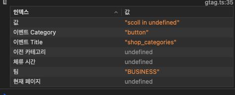
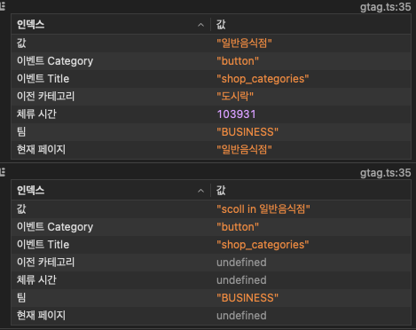

# 해결 (1)

원문 페이지 ID: e8e0221954bc82899c36015f6dbaf1cf

> 원문 스냅샷. 명세 확정·앱 배포·수집 완료를 뜻하지 않습니다.

## 원문 속성

```json
{
  "title": "해결 (1)"
}
```


<p>
웹: 
</p>

<ol>
<li>
헤더나 푸터를 통하여 주변상점을 들어가게 될때 생기는 문제 
</li>
</ol>




<p>
→ 헤더나 푸터를 통하여 들어가게 되면 undefined가 아닌 전체보기를 넣어주시면 감사하겠습니다. 
</p>


<ol start="2">
<li>
스크롤 이후 카테고리를 변경하면 자동으로 스크롤 이벤트가 감지되고 있는 이슈 
</li>
</ol>



→ 카테고리 변경할 때 안 생기게 처리해주시면 감사하겠습니다…!


