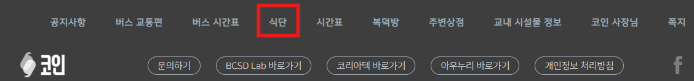
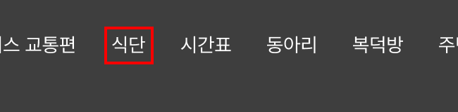
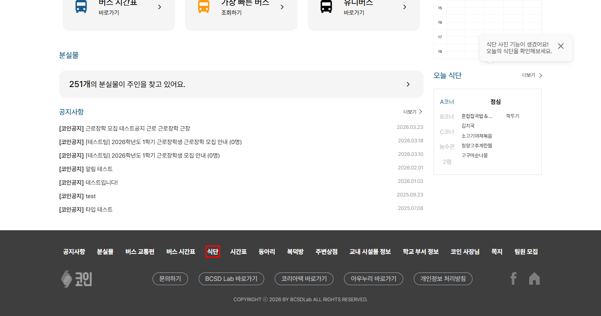

# 2-2. 푸터_식단_클릭

원문 페이지 ID: ea00221954bc82db852e810195c314ce

> 누락 원본 복구 스냅샷. 원본의 과거값·검토 기록을 보존하며 생성 계약으로 자동 승인하지 않습니다.

대조 기록: [87개 원본 복구 및 8개 차이 정리](../recovery-review.md)

관련 기존 보관본: [2-2. 푸터_식단_클릭](5db0221954bc82bd9ef801061752b129.md), [2-1. 헤더_식단_클릭](d160221954bc83abb8618181d83f8ae1.md), [2-2. 푸터_버스 시간표_클릭](ec80221954bc835b8b0b81b7005069a3.md), [2-4. 푸터_버스 교통편_클릭](7bb0221954bc826ba4d9011b5a841e45.md)

## 원문 속성

```json
{
  "platform": [
    "WEB"
  ],
  "url": "source-page-id:ea00221954bc82db852e810195c314ce",
  "상태": "완료",
  "생성일": "2026-11-08T10:51:35.698Z",
  "이름": "2-2. 푸터\\_식단\\_클릭",
  "태그": [
    "2. 헤더/푸터/햄버거_식단"
  ]
}
```

<details>
<summary>이전 로깅</summary>


- event\_label : “footer”
- value : “식단<b>”</b>
- event\_category : “click”
- 참고사진





</details>


<details>
<summary>새 로깅 (26.10.17)</summary>


- 설명: 웹 하단 푸터에서 식단을 클릭해 식단 화면으로 들어가는 경우
- screen\_view: <code>footer</code>
- event\_name: <code>DA1</code>
- event\_label: <code>cafeteria__footer__cafeteria_entry__footer_entry__click</code>
- value: 식단
- event\_category: <code>click</code>

<details>
<summary>검토사항</summary>


- screen\_view 확정 (2026-10-30 상민 직접 지시): event\_label의 두 번째 구간과 같은 <code>footer</code> 고정값을 사용한다. 이전 동적 화면명 표기안은 이 결정으로 대체한다. 라벨·category·value·발생 시점·플랫폼·사진은 유지하며 SDK 적용·실제 전송·한 번 전송은 미확인이다.
- 통합 가이드·후속: [로깅 통합 가이드](3c30221954bc8214b1c481c5bbb6fba5.md)
- 모바일: 없음 (웹 전용 푸터)
- label DA2 기준 정렬 (2026-10-27): <code>cafeteria__footer__entry__click</code> → <code>cafeteria__footer__cafeteria_entry__footer_entry__click</code>

</details>


### 참고사진 (WEB 리디자인 · 푸터 식단)

<b>웹</b>

<details>
<summary>참고사진 · 웹</summary>


[Figma 원본](https://www.figma.com/design/DPlcYuiFxhyT5ULbqec59i/KOIN-Web?node-id=17664-28870) · 2026-11-04. 원본 캡처에 빨간 네모만 추가했다. 빨간 네모는 기존 명세의 식단 클릭 위치다. 실제 SDK 적용·배포·전송은 미확인이다.


<b>클릭 위치 확대</b>





</details>


<b>기존 참고사진 (과거 디자인·원문 보존)</b>

### 참고사진 (푸터 식단 클릭)


<b>웹</b>

<details>
<summary>참고사진 · 웹</summary>


웹 — 푸터 식단 클릭 (출처: stage 실제 캡처, 빨간 네모 = 클릭 위치)





</details>


<b>모바일</b>

<details>
<summary>참고사진 · 모바일</summary>


해당 없음 (웹 전용)

</details>


</details>
