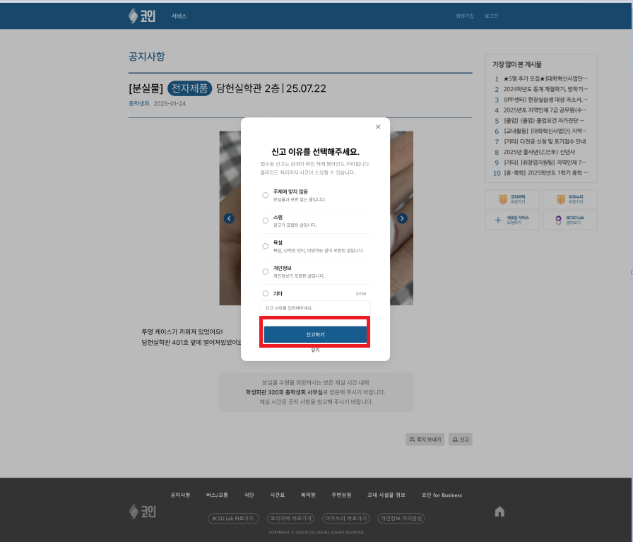
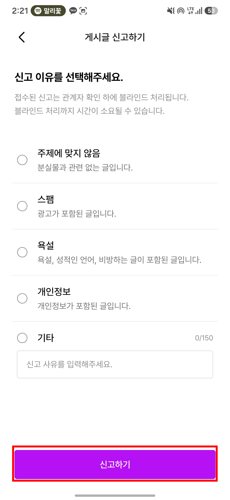

# 11-14.분실물_게시글신고하기_신고하기_클릭

원문 페이지 ID: ea90221954bc8334a6f301da1af7a7ae

> 원문 스냅샷. 명세 확정·앱 배포·수집 완료를 뜻하지 않습니다.

## 원문 속성

```json
{
  "platform": [
    "ANDROID",
    "IOS",
    "WEB"
  ],
  "url": "source-page-id:ea90221954bc8334a6f301da1af7a7ae",
  "상태": "완료",
  "이름": "11-14.분실물\\_게시글신고하기\\_신고하기\\_클릭",
  "태그": [
    "11.분실물"
  ]
}
```

<details>
<summary>이전 로깅</summary>

- 설명:  게시글 신고하기에서 신고하기 버튼 클릭
- event\_label : “item\_post\_report\_confirm”
- value : <s>\{”주제에 맞지 않음”, ”스팸”, ”욕설”, ”개인정보”, ”기타”\} 5가지 값중 선택된 값을 추가</s>

→ value : “신고하기”

- event\_category : “click”
- 참고사진


WEB


Mobile\_Web\_VIEW


</details>

<details>
<summary>새 로깅 (26.10.12) — 초안</summary>

- 설명: 게시글 신고하기에서 신고하기 버튼 클릭
- screen\_view: <code>lost_item_report</code>
- event\_name: <code>DA2</code>
- event\_label: <code>board__lost_item_report__lost_item_report__submit</code>
- value: 신고하기
- event\_category: <code>submit</code>

<details>
<summary>검토사항</summary>

- 웹·모바일 공통 계약 (2026-11-05 사용자 승인): 같은 기능의 screen\_view와 event\_label은 플랫폼과 관계없이 아래 공통값을 사용한다. 기존 플랫폼별 화면명 유지 지시는 이 결정으로 대체한다. 플랫폼은 기존 DB 속성으로 구분하며 value·event\_name·event\_category·기존 전송 시점·이전 로깅·사진은 유지한다. 실제 SDK 적용·배포·단일 전송은 미확인이다. 공통값: <code>lost_item_report</code> / <code>board__lost_item_report__lost_item_report__submit</code>.
- 통합 가이드·후속: [로깅 통합 가이드](3c30221954bc8214b1c481c5bbb6fba5.md)
- 신고 내용 제출 시점이며 실제 신고 처리 성공 시점과 구분한다. WEB의 신고 모달과 모바일의 별도 신고 화면 모두 신고 작성이라는 논리 화면 lost\_item\_report를 사용한다. 종전 lost\_item\_detail/ lost\_item\_report 플랫폼 분리안은 대체한다.
</details>

### 참고사진 (기능 표시)

<columns>
<column ratio="50">
<b>웹</b>

<details>
<summary>참고사진 · 웹</summary>

PC 웹 — 신고 모달 제출 (기존 로깅 캡처)


</details>
</column>
<column ratio="50">
<b>모바일</b>

<details>
<summary>참고사진 · 모바일</summary>

모바일 — 별도 신고 화면의 신고하기


</details>
</column>
</columns>
</details>
