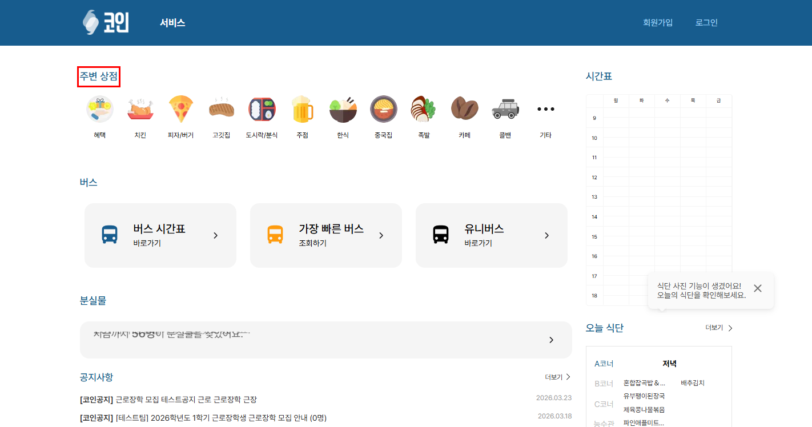
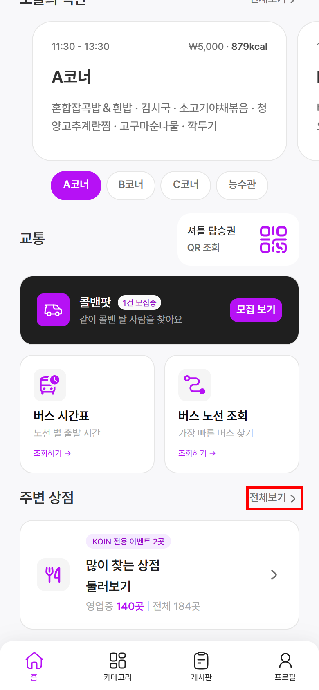
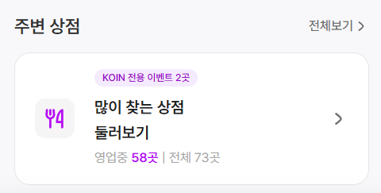

# 1-1-1 메인 → 주변상점 (클릭) -  (레거시)

원문 페이지 ID: eb00221954bc8243aa648128d0c8d47c

> 원문 스냅샷. 명세 확정·앱 배포·수집 완료를 뜻하지 않습니다.

## 원문 속성

```json
{
  "platform": [
    "WEB",
    "WEB (모바일)",
    "IOS",
    "ANDROID"
  ],
  "url": "source-page-id:eb00221954bc8243aa648128d0c8d47c",
  "상태": "완료",
  "생성일": "2026-11-08T10:51:47.157Z",
  "이벤트 이름": "1-1-1 메인 → 주변상점 (클릭) -  (레거시)",
  "태그": [
    "1. 메인 -> 카테고리"
  ]
}
```

<callout icon="📁" color="gray_bg">
<b>레거시 보존 · 현행 새 로깅은 홈으로 이관</b>

- 2026-11-04 사용자 지시로 이 페이지는 이력만 보존한다.
- 현행 기준 명세: [1-9 주변 상점 전체보기 클릭](e730221954bc825c92350132993b4f22.md).
- 이관 후 event\_label: <code>main__main__shop_entry__main_entry__click</code>. 아래 이관 전 라벨·값·사진은 보존 기록이며 별도 신규 구현·추가 전송 대상으로 사용하지 않는다.
- 실제 SDK 전환·배포·수집 중단 여부는 미확인이다. 기존 플랫폼과 상태 속성은 유지했다.
</callout>

<details>
<summary>이전 로깅</summary>

- 없음 (새로 추가한 로깅)
</details>

<details>
<summary>이관 전 새 로깅 (26.10.17) — 레거시 보존</summary>

- 설명: 메인에서 주변 상점 카테고리 아무거나 클릭
- screen\_view: <code>main</code>
- event\_name: <code>DA1</code>
- event\_label: <code>shop__main__shop_entry__main_entry__click</code>
- value: 주변상점
- event\_category: <code>click</code>

<details>
<summary>검토사항</summary>

- label DA2 기준 정렬 (2026-10-27): <code>shop__main__entry__click</code> → <code>shop__main__shop_entry__main_entry__click</code> / 통합 가이드: [로깅 통합 가이드](3c30221954bc8214b1c481c5bbb6fba5.md)
</details>

### 참고사진 (메인 → 주변상점 클릭)

<columns>
<column ratio="50">
<b>웹</b>

<details>
<summary>이관 전 WEB 참고사진 (구디자인·레거시)</summary>

웹 — 메인 → 주변상점 클릭 (출처: stage 실제 캡처, 빨간 네모 = 클릭 위치)


</details>
</column>
<column ratio="50">
<b>모바일</b>

<details>
<summary>참고사진 · 모바일</summary>

모바일 — 메인 → 주변상점 클릭 (출처: stage 실제 캡처, 빨간 네모 = 클릭 위치)




</details>
</column>
</columns>
</details>
