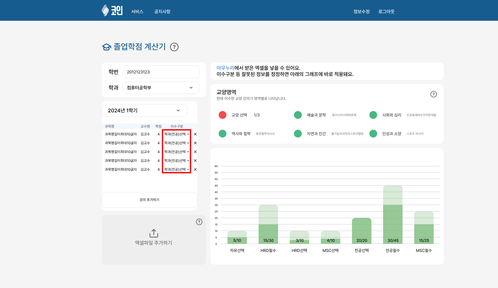

# 3-10. 졸업학점 계산기_이수 구분 드롭다운 (클릭)

원문 페이지 ID: eb10221954bc82fcb4fd815972ca5fb4

> 원문 스냅샷. 명세 확정·앱 배포·수집 완료를 뜻하지 않습니다.

## 원문 속성

```json
{
  "platform": [
    "WEB"
  ],
  "url": "source-page-id:eb10221954bc82fcb4fd815972ca5fb4",
  "구분": "졸업학점 계산기 내부",
  "상태": "레거시",
  "생성일": "2026-11-12T05:08:12.860Z",
  "이벤트 이름": "3-10. 졸업학점 계산기\\_이수 구분 드롭다운 (클릭)",
  "태그": [
    "졸업학점 계산기"
  ]
}
```

<details>
<summary>이전 로깅</summary>

- event\_label : “graduation\_calculator\_completion\_category”
- value : “이수 구분\_\{이수 구분 카테고리\}<b>”</b>
- event\_category : “click”
- 참고 이미지
  


</details>

<details>
<summary>과거 리네이밍 초안 — 레거시 (현행 적용 제외)</summary>

- 분류: 레거시
- 분류일: 2026-10-15
- 레거시 사유: 현재 웹 시간표·서비스 메뉴에서 졸학계 진입점을 확인할 수 없으며, 사용자가 서비스 제거로 판단해 레거시 분류를 지시함. 현행 화면 정의·신규 리네이밍 적용 대상에서 제외하고 기존 로그·사진은 과거 참고 자료로 보존한다. 서비스 종료일·코드 전체 삭제 여부는 미확인.
- 작성일: 2026-10-14
- 보존 자료: 2026-10-14 작성 당시의 리네이밍 초안. 아래 화면명·label·검토사항은 현행 적용값이 아닌 과거 자료이며, DB 상태는 레거시로 분류한다.
- 기존 적용 플랫폼: WEB. iOS 실제 화면은 미검수.
- 설명: 졸학계 강의 목록에서 이수 구분을 선택한다.
- screen\_view: <code>grad_calc</code>
- event\_label: <code>grad_calc__grad_calc__grad_lecture__completion_category</code>
- event\_name: 기존 값 유지 (본문 미기재 / 수집값 확인 필요)
- value: 이수 구분\_\{이수 구분 카테고리\}
- event\_category: <code>click</code>
- 화면명 근거: 원문 (원문 ID: 4129ae650b59804fbe20e3a332b84b2a). 정의 제안과 실제 전송값 검수는 별도.

### 참고사진 (기능 표시)

<b>웹(데스크톱)</b>

기존 웹 명세 캡처 사본. 현재 구현·진입 경로 미확인. 로그인 이후 UI의 기존 디자인 자료. Figma 참고 / 현재 실제 화면 미확인.


</details>
