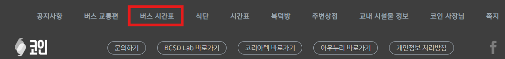
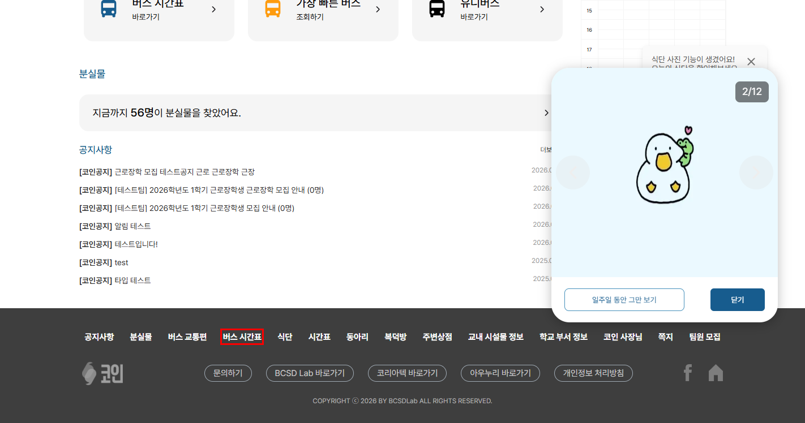

# 2-2. 푸터_버스 시간표_클릭

원문 페이지 ID: ec80221954bc835b8b0b81b7005069a3

> 원문 스냅샷. 명세 확정·앱 배포·수집 완료를 뜻하지 않습니다.

## 원문 속성

```json
{
  "platform": [
    "WEB"
  ],
  "url": "source-page-id:ec80221954bc835b8b0b81b7005069a3",
  "상태": "완료",
  "생성일": "2026-11-12T05:07:53.627Z",
  "이벤트 이름": "2-2. 푸터\\_버스 시간표\\_클릭",
  "태그": [
    "2. 헤더/푸터/햄버거_버스/교통"
  ]
}
```

<details>
<summary>과거 로깅</summary>

- event\_label : “footer”
- value : “버스 시간표<b>”</b>
- event\_category : “click”
- 참고사진


</details>

<details>
<summary>새 로깅</summary>

- 설명: 웹 하단 푸터에서 버스 시간표를 클릭해 버스 시간표 화면으로 들어가는 경우
- screen\_view: <code>footer</code>
- event\_name: <code>DA1</code>
- event\_label: <code>bus__footer__timetable__click</code>
- value: 버스 시간표
- event\_category: <code>click</code>

### 참고사진 (기능 표시)

<columns>
<column ratio="50">
<b>웹</b>

<b>참고사진 · 웹</b>

웹 — 푸터 버스 시간표 (출처: stage 실제 캡처, 빨간 네모 = 클릭 위치)


</column>
<column ratio="50">
<b>모바일</b>

<b>참고사진 · 모바일</b>

모바일 — 해당 없음 (웹 전용)
</column>
</columns>
</details>
