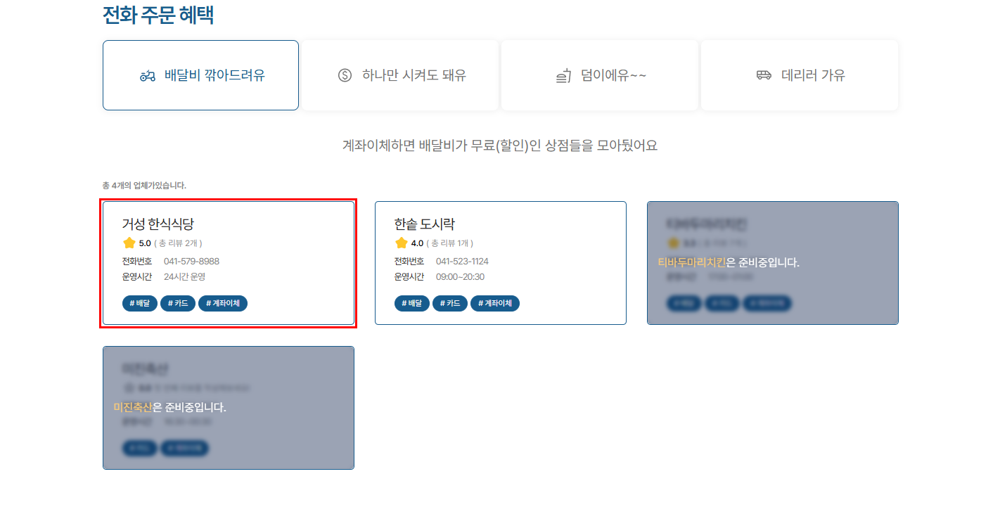
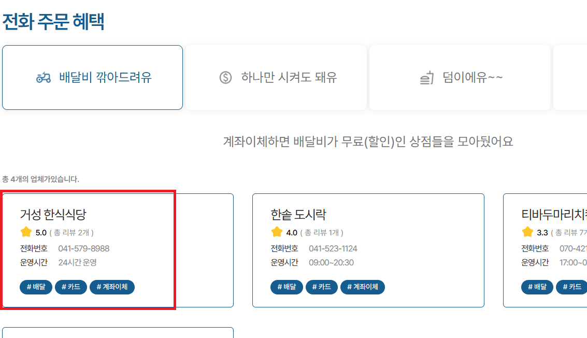

# 4-4 전화 주문 혜택 상점상세 페이지(클릭)

원문 페이지 ID: ecc0221954bc823a81980126d81964ea

> 원문 스냅샷. 명세 확정·앱 배포·수집 완료를 뜻하지 않습니다.

## 원문 속성

```json
{
  "platform": [
    "WEB",
    "ANDROID",
    "IOS"
  ],
  "url": "source-page-id:ecc0221954bc823a81980126d81964ea",
  "상태": "완료",
  "생성일": "2026-11-08T10:51:46.624Z",
  "이벤트 이름": "4-4 전화 주문 혜택 상점상세 페이지(클릭)",
  "태그": [
    "4. 혜택 페이지"
  ]
}
```

<details>
<summary>이전 로깅</summary>

<span color="orange">event\_params.key</span>

- event\_label : benefit\_shop\_click
- value : \{상점이름\}
- event\_category : click <br />
- previous\_page : \{버튼\}
- current\_page : \{상점이름\}
- duration\_time : 혜택페이지에서 상점페이지로 들어온 시간 (ms)
</details>

<details>
<summary>새 로깅 (26.10.17)</summary>

- 설명: 전화 주문 혜택 화면에서 가게를 클릭해 상점 상세 화면으로 들어가는 경우
- screen\_view: <code>shop_benefit</code>
- event\_name: <code>DA1</code>
- event\_label: <code>shop__shop_benefit__shop_detail__entry__click</code>
- value: \{상점이름\} (예: 복지관 매점)
- event\_category: <code>click</code>

<details>
<summary>검토사항</summary>

- 통합 가이드: [로깅 통합 가이드](3c30221954bc8214b1c481c5bbb6fba5.md)
- label DA2 기준 정렬 (2026-10-27): <code>shop__shop_benefit__shop__click</code> → <code>shop__shop_benefit__shop_detail__entry__click</code>
</details>

### 참고사진 (혜택 화면 → 상점 상세)

<columns>
<column ratio="50">
<b>웹</b>

<details>
<summary>참고사진 · 웹</summary>

웹 — 혜택 화면 가게 클릭 (출처: stage 실제 캡처, 빨간 네모 = 클릭 위치)




</details>
</column>
<column ratio="50">
<b>모바일</b>

<details>
<summary>참고사진 · 모바일</summary>

파란색 구버전 모바일 사진 제거 (2026-10-30).
</details>
</column>
</columns>
</details>
