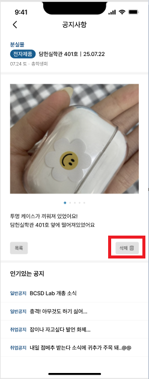
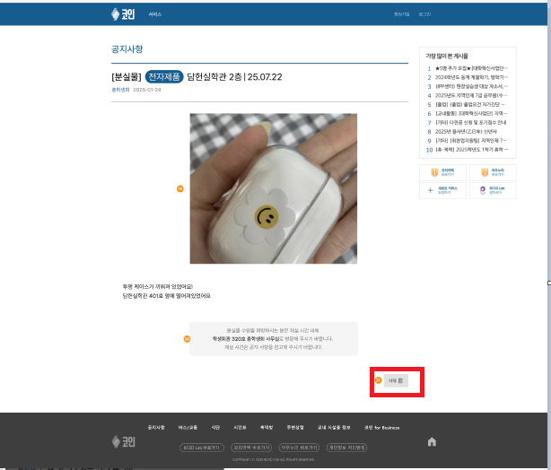
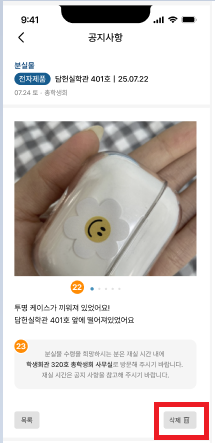

# 11-5.분실물_습득물신고_삭제_클릭

원문 페이지 ID: edb0221954bc833db80201bdd2fdf8fe

> 사용자 제공 ZIP 내보내기 보관본. 레거시·동결·검토 상태는 원문을 따르며 코드 생성 승인·앱 배포 완료를 뜻하지 않습니다.

platform: ANDROID, IOS, WEB
상태: 완료

- 설명:  글 작성자가 습득물 신고 게시물에서 삭제버튼을 클릭
- event_label : “find_user_delete”
- value : “삭제”
- event_category : “click”
- 참고사진

WEB Mobile View

