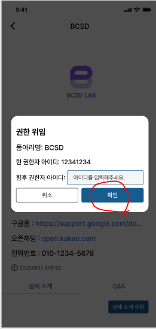
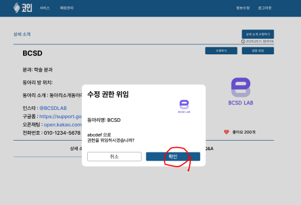

# 5-5.동아리_권한위임 확인

원문 페이지 ID: ee60221954bc830bb36001182c0f3e34

> 필터 밖 원본 행 복구 스냅샷. 중복·빈 페이지도 원본 ID와 속성, 본문을 개별 보존합니다. 명세 승인이나 앱 적용 완료를 뜻하지 않습니다.

대조 기록: [숨겨진 원본 42개 복구](../hidden-recovery.md)

관련 기존 보관본: [레거시 5-5.동아리_권한위임 확인](f9d0221954bc8293925d8142db67fd37.md), [레거시 5-5.동아리_권한위임 확인](24a0221954bc8353b99781b1c46a773f.md)

## 원문 속성

```json
{
  "platform": [
    "ANDROID",
    "IOS",
    "WEB"
  ],
  "url": "source-page-id:ee60221954bc830bb36001182c0f3e34",
  "상태": "완료",
  "이름": "5-5.동아리\\_권한위임 확인"
}
```

- 설명: 권한위임 팝업에서 확인버튼 클릭


주의사항: 


- 모바일 - 확인을 눌렀는데 아이디를 기입하지 않아서 처리가 안된경우와 같이 권한위임 처리가 안된 경우는 제외.
- 웹 - 웹의 경우는 재확인 팝업창을 기준으로 로깅을 진행

---

<ul>
<li>
event\_name : “CAMPUS”
</li>
<li>
event\_label : “club\_delegation\_authority\_confirm”
</li>
<li>
value : “권한위임”
</li>
<li>
event\_category : “click” 
</li>
<li>
참고사진
</li>
</ul>





- 웹 참고사진



