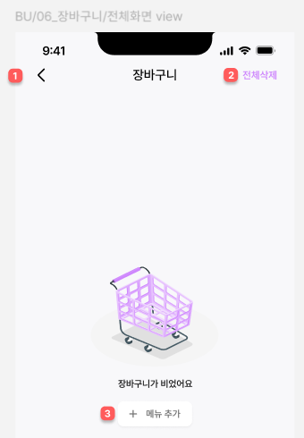

# 6-1 장바구니 진입 후 뒤로가기

원문 페이지 ID: eeb0221954bc839184398134bbfaa0e2

> 원문 스냅샷. 명세 확정·앱 배포·수집 완료를 뜻하지 않습니다.

## 원문 속성

```json
{
  "platform": [
    "ANDROID",
    "IOS"
  ],
  "url": "source-page-id:eeb0221954bc839184398134bbfaa0e2",
  "상태": "로깅 필요",
  "생성일": "2026-11-08T10:51:53.888Z",
  "이벤트 이름": "6-1 장바구니 진입 후 뒤로가기"
}
```



장바구니 진입 후, 좌측 상단의 버튼 또는 스와이프로 이탈 로깅입니다.


<span color="orange">event\_params.key</span>

<ul>
<li>
event\_label : cart\_back
</li>
<li>
value : 
</li>
<li>
event\_category : 

<ul>
<li>
click 
</li>
<li>
swipe
</li>
</ul>
</li>
<li>
previous\_page : 장바구니
</li>
<li>
current\_page : \{카테고리\}
</li>
<li>
duration\_time : 장바구니에서 머무르는 시간  
</li>
</ul>
