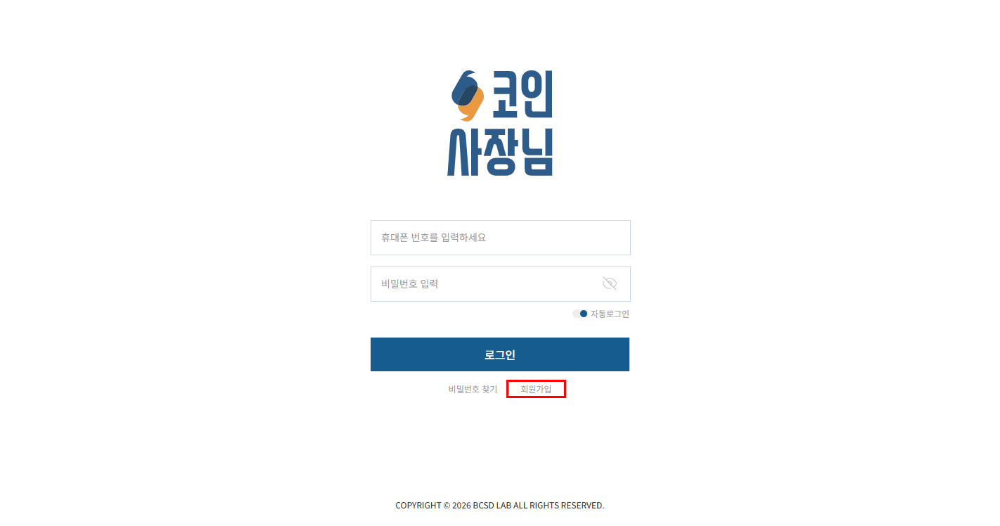

# 4-3 로그인 - 회원가입 (클릭) - 추가된 로깅

원문 페이지 ID: eef0221954bc8302a361815f65b5928a

> 원문 스냅샷. 명세 확정·앱 배포·수집 완료를 뜻하지 않습니다.

## 원문 속성

```json
{
  "platform": [
    "WEB"
  ],
  "url": "source-page-id:eef0221954bc8302a361815f65b5928a",
  "상태": "로깅 필요",
  "생성일": "2026-11-12T05:07:39.840Z",
  "이벤트 이름": "4-3 로그인 - 회원가입 (클릭) - 추가된 로깅"
}
```

<details>
<summary>과거 로깅</summary>

- 없음 (새로 추가한 로깅)
</details>

<details>
<summary>새 로깅</summary>

- 설명: 사장님 로그인 화면(/login) 하단의 회원가입을 클릭해 회원가입 화면(/signup)으로 들어가는 경우
- screen\_view: <code>owner_login</code>
- event\_name: <code>DA1</code>
- event\_label: <code>owner__owner_login__sign_up__entry__click</code>
- value: 회원가입
- event\_category: <code>click</code>

### 참고사진 (회원가입)

<columns>
<column ratio="50">
<b>웹</b>

<b>참고사진 · 웹</b>

웹 — 회원가입 (출처: stage 실제 캡처, 빨간 네모 = 클릭 위치)


</column>
<column ratio="50">
<b>모바일</b>

<b>참고사진 · 모바일</b>

파란색 구버전 모바일 사진 제거 (2026-10-30).
</column>
</columns>
</details>
