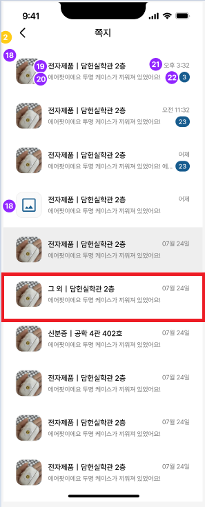
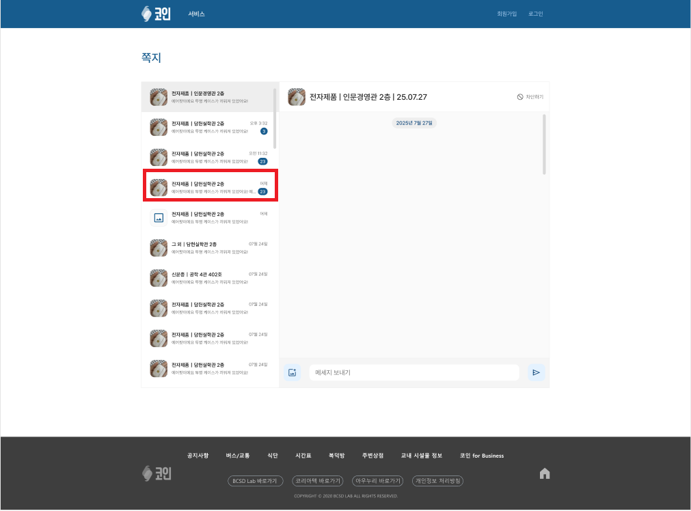

# 11-16.쪽지리스트_대화창_클릭

원문 페이지 ID: f020221954bc830ab4fc8147ebdafd6f

> 사용자 제공 ZIP 내보내기 보관본. 레거시·동결·검토 상태는 원문을 따르며 코드 생성 승인·앱 배포 완료를 뜻하지 않습니다.

platform: ANDROID, IOS, WEB
상태: 완료

- 설명:  쪽지 리스트에서 특정 대화창을 클릭
- event_label : “message_list_select”
- value : “쪽지”
- event_category : “click”
- 참고사진

Mobile, Mobile_Web_VIEW

WEB

- 검토사항
    - 후속 수정 (2026-10-27): ※ 옛 사본: 현행 명세는 게시판 DB의 같은 번호 페이지 [11-16.쪽지리스트_대화창_클릭](cb20221954bc8335977e012e2347e4ee.md). 이 사본은 새 로깅이 없어 변환하지 않음.
