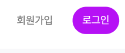
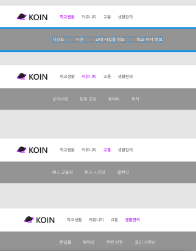
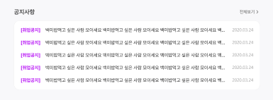
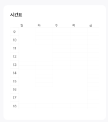

# 홈화면 리디자인

원문 페이지 ID: f1b0221954bc8342bd9781c149b826b0

> 원문 스냅샷. 명세 확정·앱 배포·수집 완료를 뜻하지 않습니다.

## 원문 속성

```json
{
  "title": "홈화면 리디자인"
}
```

<callout icon="💡" color="gray_bg">
Firebase (<b>screen\_view</b>)
</callout>

버스 로깅 (3) (collection-id:38802219-54bc-83d8-8129-87090586a53a)


### 추가 참고사진 (WEB 리디자인 · 사용자 제공)

2026-11-04 제공된 6개 파일 중 동일한 배너 2개를 한 장으로 정리해 고유 이미지 5개를 아래에 보존한다. 개별 기존 명세에는 선택선이 없는 Figma 원본에 빨간 네모를 표시한 이미지를 연결했다. 이 모음의 파란 선은 Figma 선택 표시이며 클릭 대상 표시가 아니다.

<details>
<summary>참고사진 · 웹 — 회원가입·로그인</summary>

로그인 사진은 기존 계정 헤더 로그인 명세에 이미 반영되어 있다. 이번에는 회원가입 명세에 클릭 표시 이미지를 추가했다.


</details>

<details>
<summary>참고사진 · 웹 — 상단 메뉴 4개 상태</summary>

학교생활·커뮤니티·교통·생활편의 메뉴. 팀원 모집 명세는 수정하지 않았다. 콜밴팟·코인 사장님 헤더와 최상위 메뉴 열기 동작은 대응 명세·동작 확인 후 판단한다.


</details>

<details>
<summary>참고사진 · 웹 — 공지사항</summary>

전체보기·영역 제목·게시글의 기존 명세에 각각 위치 표시 사진을 추가했다. 제목 자체의 클릭 가능 여부는 미확인이다.


</details>

<details>
<summary>참고사진 · 웹 — 고정 배너와 시간표 위젯 (계약 미확정)</summary>

동일 파일이던 고정 배너 사진은 한 장만 유지했다. 고정 배너는 기존 모달과, 시간표 위젯은 APP 프로필 버튼과 구분한다. 새 라벨·전송은 만들지 않는다.



</details>
