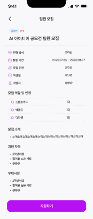
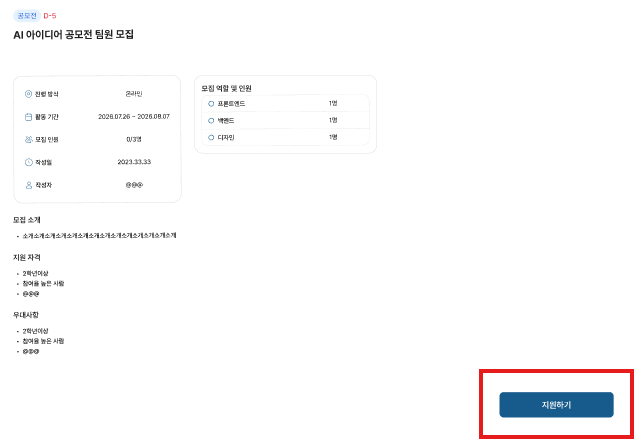
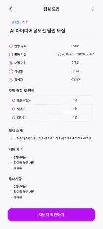
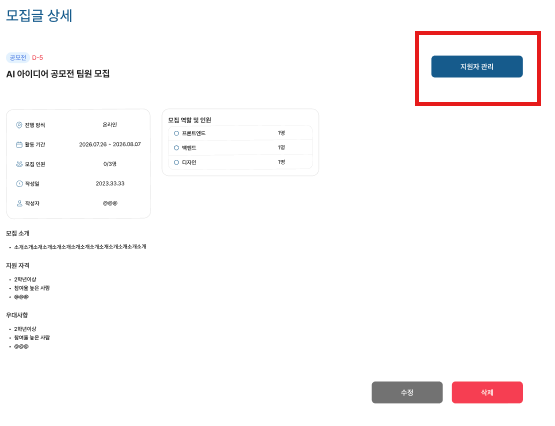
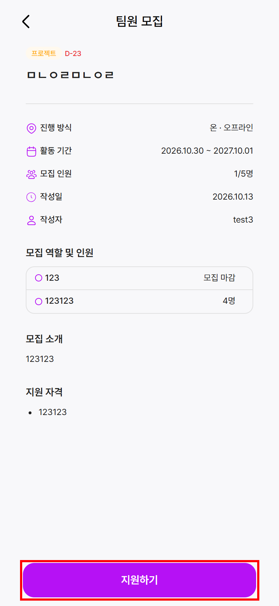
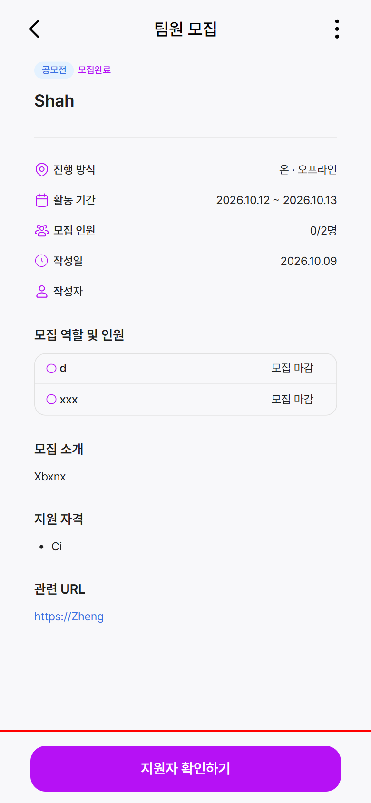

# 4. 모집글 상세

원문 페이지 ID: f2f0221954bc827dadb7014c80837f67

> 원문 스냅샷. 명세 확정·앱 배포·수집 완료를 뜻하지 않습니다.

## 원문 속성

```json
{
  "platform": [
    "WEB",
    "ANDROID",
    "IOS"
  ],
  "url": "source-page-id:f2f0221954bc827dadb7014c80837f67",
  "구분": "모집글 상세 지원자",
  "상태": "로깅 필요",
  "생성일": "2026-11-12T05:08:08.460Z",
  "이벤트 이름": "4\\. 모집글 상세"
}
```

<details>
<summary>과거 로깅</summary>

① 지원하기 버튼 클릭

- event\_label : team\_recruitment\_post\_apply
- value : \{사용자가 지원한 게시글 이름으로 나오게 해주세요\}
- event\_category : “click”






② 지원자 확인하기 버튼 클릭

- event\_label : team\_recruitment\_post\_applicant\_check
- value : \{사용자가 확인한 게시글 이름으로 나오게 해주세요\}
- event\_category : click




</details>

<details>
<summary>새 로깅</summary>

① 지원하기 버튼 클릭

- 설명: 모집글 상세 화면 하단의 지원하기 버튼을 클릭해 지원서 작성 화면으로 들어가는 경우 (비로그인이면 로그인 안내 팝업이 뜸)
- screen\_view: <code>team_detail</code>
- event\_name: <code>DA1</code>
- event\_label: <code>team_recruit__team_detail__team_apply__entry__click</code>
- value: \{카테고리\}\_\{모집글 id\} (예: 프로젝트\_103)
- event\_category: <code>click</code>

② 지원자 확인하기 버튼 클릭

- 설명: 내가 작성한 모집글의 상세 화면에서 지원자 확인하기 버튼을 클릭해 지원자 관리 화면으로 들어가는 경우 (작성자만 보임)
- screen\_view: <code>team_detail</code>
- event\_name: <code>DA1</code>
- event\_label: <code>team_recruit__team_detail__team_applicant__entry__click</code>
- value: \{카테고리\}\_\{모집글 id\} (예: 프로젝트\_103)
- event\_category: <code>click</code>

### 참고사진 (모집글 상세)

① 지원하기 버튼 클릭

<columns>
<column ratio="50">
<b>웹</b>

<b>참고사진 · 웹</b>

웹 — 사진 없음 (추가 필요)
</column>
<column ratio="50">
<b>모바일</b>

<b>참고사진 · 모바일</b>

모바일 — 지원하기 (출처: stage 실제 캡처, 빨간 네모 = 클릭 위치)


</column>
</columns>

② 지원자 확인하기 버튼 클릭

<columns>
<column ratio="50">
<b>웹</b>

<b>참고사진 · 웹</b>

웹 — 사진 없음 (추가 필요)
</column>
<column ratio="50">
<b>모바일</b>

<b>참고사진 · 모바일</b>

모바일 — 지원자 확인하기 (출처: stage 로그인 상태 실제 캡처, 빨간 네모 = 클릭 위치)


</column>
</columns>
</details>
