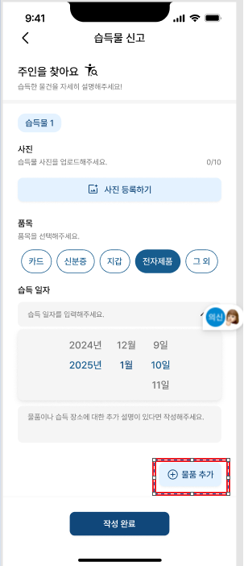
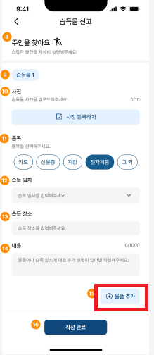

# 11-3.분실물_습득물신고_물품추가_클릭

원문 페이지 ID: f310221954bc83bebe1e01cbe8c00494

> 사용자 제공 ZIP 내보내기 보관본. 레거시·동결·검토 상태는 원문을 따르며 코드 생성 승인·앱 배포 완료를 뜻하지 않습니다.

platform: ANDROID, IOS, WEB
상태: 완료

- 설명:   습득물 신고 글쓰기 페이지에서 물품 추가 클릭
- event_label : “find_user_add_item”
- value : “물품 추가”
- event_category : “click”
- 참고사진

WEB Mobile View

