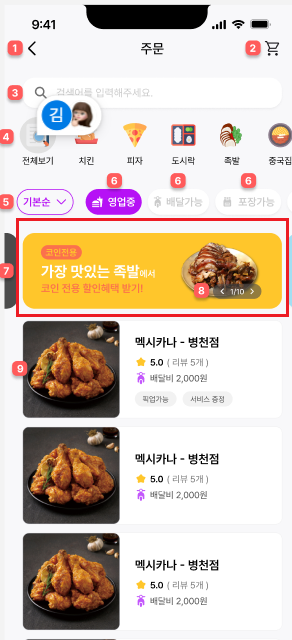

# 2-3 상점카테고리 이벤트 (클릭) 

원문 페이지 ID: f320221954bc83b29de1816de358d1f1

> 원문 스냅샷. 명세 확정·앱 배포·수집 완료를 뜻하지 않습니다.

## 원문 속성

```json
{
  "platform": [
    "ANDROID",
    "IOS"
  ],
  "url": "source-page-id:f320221954bc83b29de1816de358d1f1",
  "상태": "로깅 필요",
  "생성일": "2026-11-12T05:07:44.827Z",
  "이벤트 이름": "<p>\n2-3 상점카테고리 이벤트 (클릭) \n</p>",
  "태그": [
    "2. 상점 카테고리"
  ]
}
```




<span color="orange">event\_params.key</span>

<ul>
<li>
event\_label : shop\_categories\_event
</li>
<li>
value : \{가게이름\}
</li>
<li>
event\_category : click 
</li>
<li>
duration\_time : 이전 카테고리에서 현 상점으로 이동하는 시간 
</li>
<li>
previous\_page : \{이전 카테고리\}
</li>
<li>
current\_page : \{가게이름\}
</li>
</ul>


---


