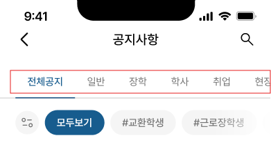
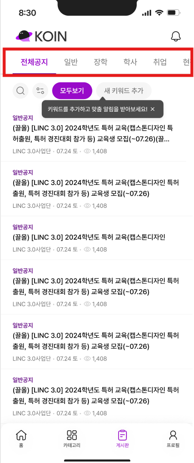

# 4-1. 탭 메뉴바_클릭

원문 페이지 ID: f380221954bc83319946015c7d177803

> 원문 스냅샷. 명세 확정·앱 배포·수집 완료를 뜻하지 않습니다.

## 원문 속성

```json
{
  "platform": [
    "ANDROID",
    "IOS"
  ],
  "url": "source-page-id:f380221954bc83319946015c7d177803",
  "상태": "로깅 필요",
  "이름": "4-1. 탭 메뉴바\\_클릭",
  "태그": [
    "4. 공지사항 상세 페이지(APP)"
  ]
}
```

<details>
<summary>이전 로깅</summary>





각 탭 명을 value값으로 추가


- event\_label : ‘notice\_tab’
- value : 각 탭 명
- event\_category : ‘click’
- 설명 : 상단의 표시된 탭 클릭시 적용
</details>

<details>
<summary>새 로깅 (26.10.05) — 초안</summary>

- 설명: 공지사항 목록 상단의 탭 선택.
- screen\_view: <code>main_notice</code>
- event\_name: <code>DA2</code>
- event\_label: <code>board__main_notice__filter__tab__select</code>
- value: \{선택한 탭명\}
- event\_category: <code>select</code>

<details>
<summary>검토사항</summary>

- label 통일 (2026-10-27): <code>board__main_notice__filter__tab_select</code> → <code>board__main_notice__filter__tab__select</code>
</details>

<details>
<summary>참고사진 · 모바일</summary>

<b>모바일</b>


</details>
</details>
