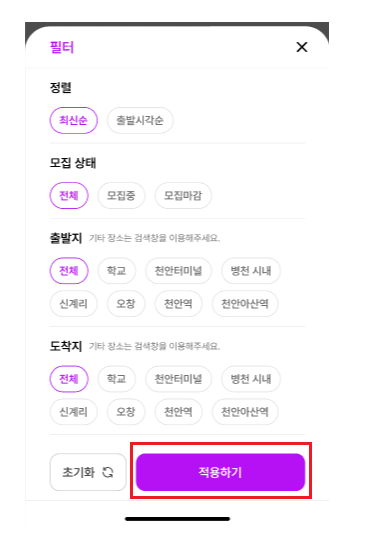
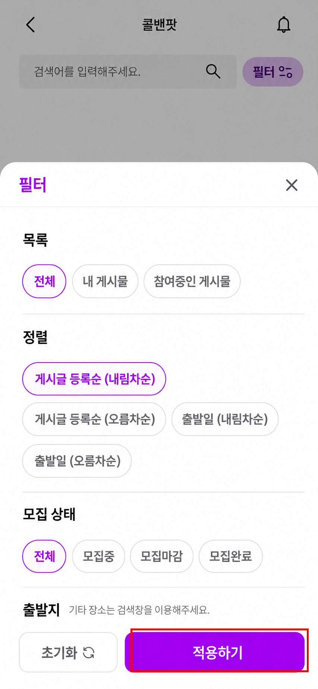

# 2-3  콜밴팟 필터 적용하기

원문 페이지 ID: f4f0221954bc8254b4e401f5d16703c4

> 원문 스냅샷. 명세 확정·앱 배포·수집 완료를 뜻하지 않습니다.

## 원문 속성

```json
{
  "platform": [
    "ANDROID",
    "IOS"
  ],
  "url": "source-page-id:f4f0221954bc8254b4e401f5d16703c4",
  "상태": "로깅 필요",
  "이름": "2-3  콜밴팟 필터 적용하기",
  "태그": [
    "2. 콜밴팟 찾기"
  ]
}
```

<details>
<summary>과거 로깅</summary>


<ul>
<li>
event\_name : CAMPUS
</li>
<li>
event\_category : click
</li>
<li>
event\_label : callvan\_filter\_apply
</li>
<li>
value : 
</li>
</ul>



</details>

<details>
<summary>새 로깅</summary>

- 설명: 목록 위 필터 바텀시트에서 적용하기를 클릭한다.
- screen\_view: <code>callvan_list</code>
- event\_label: <code>callvan__callvan_list__filter__apply__click</code>
- event\_name: <code>DA2</code>
- value: 기존 미기재 유지
- event\_category: <code>click</code>

### 참고사진 (기능 표시)

<b>모바일 (ANDROID, IOS) / 캡처 출처는 아래 참조</b>

<b>참고사진 · 모바일</b>

화면 정의의 Android 실제 캡처(2026-10-13), 선명도 개선본. 이번 작업은 기존 캡처를 사용. 추가 필터 이미지.


</details>
