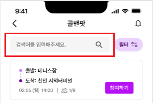
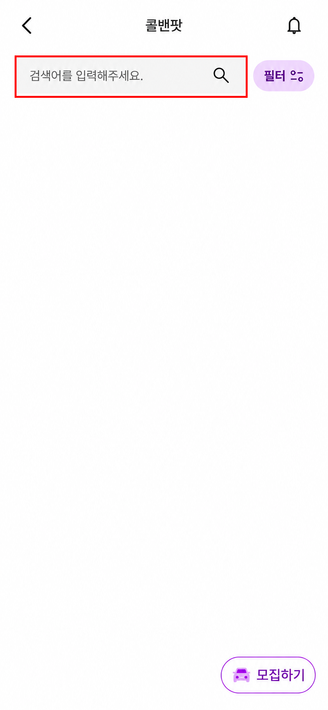

# 2-1 콜밴팟 검색바 클릭

원문 페이지 ID: f510221954bc8397948a815f765533fb

> 원문 스냅샷. 명세 확정·앱 배포·수집 완료를 뜻하지 않습니다.

## 원문 속성

```json
{
  "platform": [
    "ANDROID",
    "IOS"
  ],
  "url": "source-page-id:f510221954bc8397948a815f765533fb",
  "상태": "로깅 필요",
  "이름": "2-1 콜밴팟 검색바 클릭",
  "태그": [
    "2. 콜밴팟 찾기"
  ]
}
```

<details>
<summary>이전 로깅</summary>


<ul>
<li>
event\_name : CAMPUS
</li>
<li>
event\_category : click
</li>
<li>
event\_label : callvan\_search
</li>
<li>
value : 
</li>
</ul>





</details>

<details>
<summary>새 로깅 (2026-10-14) — 초안</summary>

- 설명: 콜밴팟 목록에서 검색 입력 영역을 클릭한다.
- screen\_view: <code>callvan_list</code>
- event\_label: <code>callvan__callvan_list__search__search_input__click</code>
- event\_name: <code>DA2</code>
- value: 기존 미기재 유지
- event\_category: <code>click</code>

<details>
<summary>검토사항</summary>

- label 통일 (2026-10-27): callvan\_\_callvan\_list\_\_search\_\_search\_input\_click → callvan\_\_callvan\_list\_\_search\_\_search\_input\_\_click
</details>

### 참고사진 (기능 표시)

<b>모바일 (ANDROID, IOS) / 캡처 출처는 아래 참조</b>

<details>
<summary>참고사진 · 모바일</summary>

화면 정의의 Android 실제 캡처(2026-10-13), 선명도 개선본. 이번 작업은 기존 캡처를 사용.


</details>
</details>
