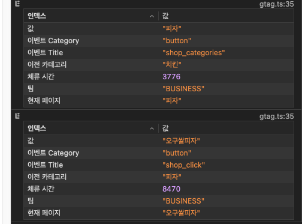

# 해결 (1)

원문 페이지 ID: f6d0221954bc8234b0cd01e4bbe48ade

> 원문 스냅샷. 명세 확정·앱 배포·수집 완료를 뜻하지 않습니다.

## 원문 속성

```json
{
  "title": "해결 (1)"
}
```


<p>
웹: 
</p>

<ol>
<li>
카테고리 이동 후 상점을 클릭하면 체류 시간이 중첩되어 적힙니다. 
</li>
</ol>



<p>
→ 카테고리 이동을 하면 타이머를 리셋하고 상점으로 들어가는 시간을 체크 해주시면 되겠습니다. 
</p>


---

<p>
안드로이드 
</p>

<p>
상점에서 나갔다가 다시 들어와도 시간이 중복되는 이슈 
</p>


