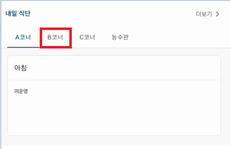
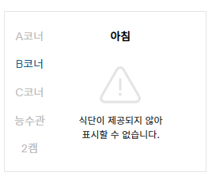

# 1-4.메인_식단_B코너_클릭

원문 페이지 ID: f710221954bc8339b99a01063004ac17

> 원문 스냅샷. 명세 확정·앱 배포·수집 완료를 뜻하지 않습니다.

## 원문 속성

```json
{
  "platform": [
    "ANDROID",
    "IOS",
    "WEB"
  ],
  "url": "source-page-id:f710221954bc8339b99a01063004ac17",
  "상태": "완료",
  "생성일": "2026-11-12T05:07:48.794Z",
  "이름": "1-4.메인\\_식단\\_B코너\\_클릭",
  "태그": [
    "1. 메인_식단"
  ]
}
```

<details>
<summary>과거 로깅</summary>

- 설명 : 메인화면에서 B코너 버튼 클릭
- event\_label : “main\_menu\_corner”
- value : “B코너<b>”</b>
- event\_category : “click”
- 참고사진



- 웹


</details>

<details>
<summary>새 로깅</summary>

- 레거시: 코너별로 나뉘어 있던 메인 식단 코너 클릭을 1-3 하나의 라벨로 합치고 코너는 value로 구분한다. 새 로깅을 만들지 않는다.
- 대체 로깅 : 1-3.메인\_식단\_A코너\_클릭 (cafeteria\_\_main\_\_corner\_\_select)

### 참고사진 (레거시)

<columns>
<column ratio="50">
<b>웹</b>

<b>참고사진 · 웹</b>

해당 없음 (레거시)
</column>
<column ratio="50">
<b>모바일</b>

<b>참고사진 · 모바일</b>

해당 없음 (레거시)
</column>
</columns>
</details>
