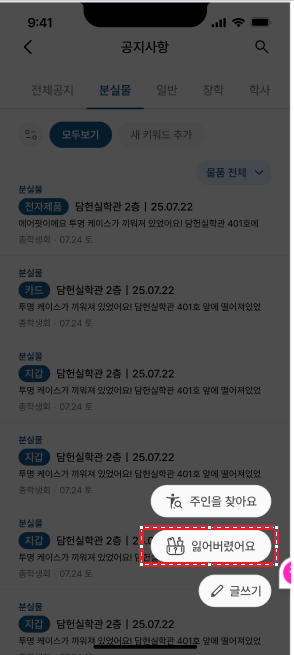
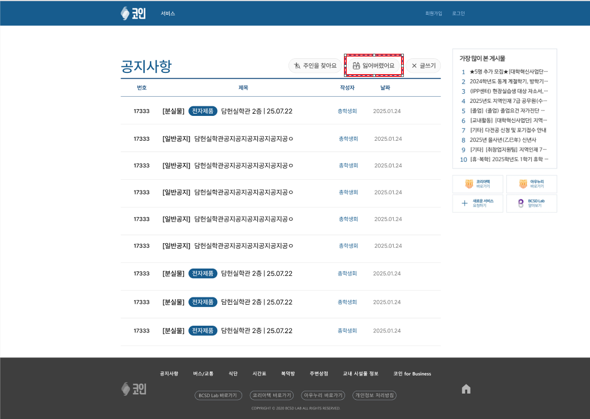
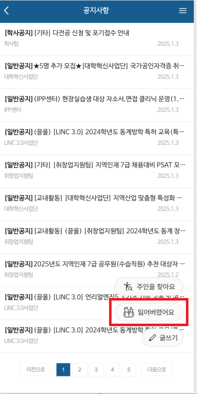

# 11-7.분실물_잃어버렸어요_클릭

원문 페이지 ID: f810221954bc83d0809e01628492c45e

> 누락 원본 복구 스냅샷. 원본의 과거값·검토 기록을 보존하며 생성 계약으로 자동 승인하지 않습니다.

대조 기록: [87개 원본 복구 및 8개 차이 정리](../recovery-review.md)

관련 기존 보관본: [11-7·11-8.분실물_글종류선택(잃어버렸어요·주인을찾아요)_클릭](a950221954bc82baaea681c164cecea6.md), [11-7·11-8.분실물_글종류선택(잃어버렸어요·주인을찾아요)_클릭](2930221954bc83208259814d626d19f4.md)

## 원문 속성

```json
{
  "platform": [
    "ANDROID",
    "IOS",
    "WEB"
  ],
  "url": "source-page-id:f810221954bc83d0809e01628492c45e",
  "상태": "완료",
  "이름": "11-7.분실물\\_잃어버렸어요\\_클릭"
}
```

- 설명: 분실물 페이지 에서 글쓰기 버튼 클릭 후 나타나는  잃어버렸어요 버튼 클릭
- event\_label : “lost\_item\_write”
- value : “잃어버렸어요”
- event\_category : “click”
- 참고사진





WEB





Mobile\_WEB\_VIEW



