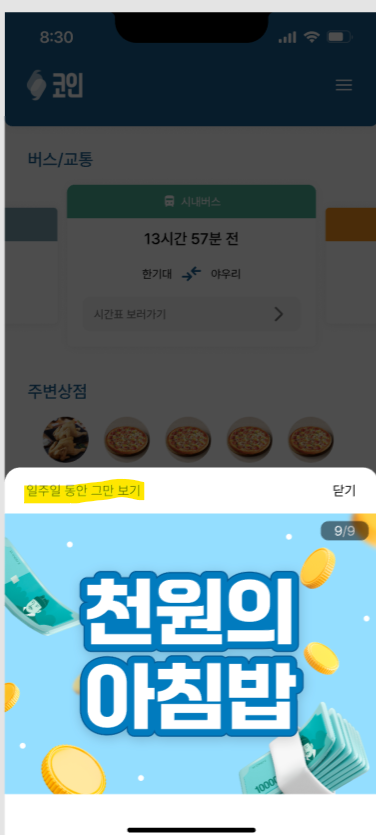
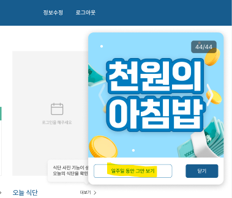
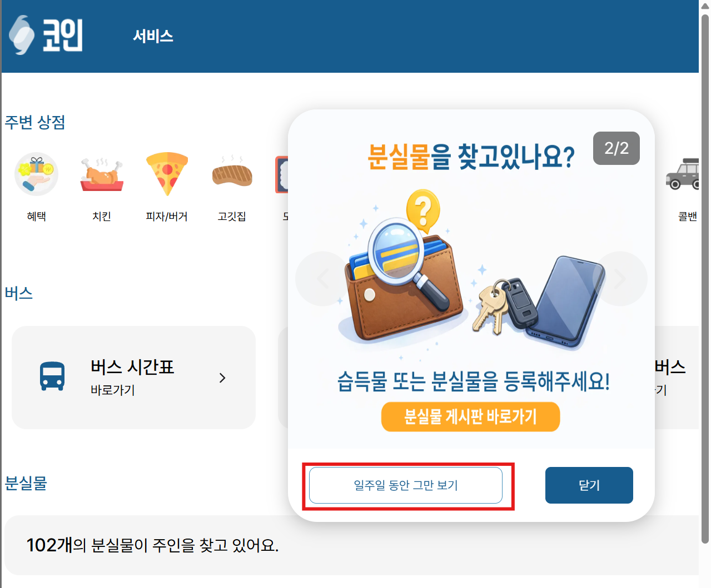
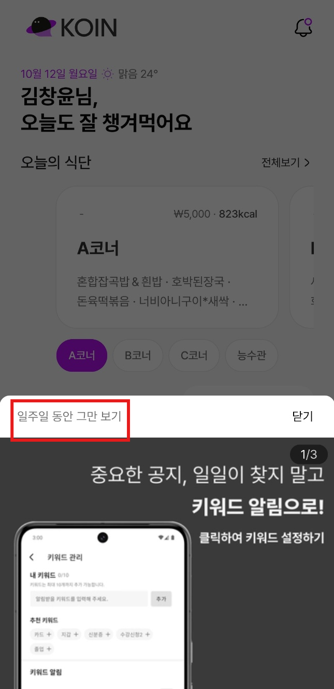

# 1-4. 메인_모달일주일닫기_클릭

원문 페이지 ID: f830221954bc83eaaa8401b369bf9231

> 원문 스냅샷. 명세 확정·앱 배포·수집 완료를 뜻하지 않습니다.

## 원문 속성

```json
{
  "platform": [
    "WEB",
    "ANDROID",
    "IOS"
  ],
  "url": "source-page-id:f830221954bc83eaaa8401b369bf9231",
  "상태": "로깅 필요",
  "이름": "1-4. 메인\\_모달일주일닫기\\_클릭",
  "태그": [
    "1. 메인_모달"
  ]
}
```

<details>
<summary>이전 로깅</summary>

- 설명: 메인화면 모달의 일주일 동안 그만 보기를 클릭
- event\_name : “CAMPUS”
- event\_label : “main\_modal\_hide\_7d”
- value : \{title값\}
- event\_category : “click”
- 참고사진




- 웹 참고사진


</details>

<details>
<summary>새 로깅 (26.10.12) — 초안</summary>

- 설명: 메인 화면의 배너 모달에서 일주일 동안 그만 보기 버튼을 클릭.
- screen\_view: main
- event\_name: <code>DA2</code>
- event\_label: <code>banner__main__modal__hide_7d__click</code>
- value: \{배너 ID\}
- event\_category: <code>click</code>

<details>
<summary>검토사항</summary>

- label 통일 (2026-10-27): <code>banner__main__modal__hide_7d</code> → <code>banner__main__modal__hide_7d__click</code>
</details>

<details>
<summary>참고사진 · 웹</summary>

<b>웹 </b>


</details>

<details>
<summary>참고사진 · 모바일</summary>

<b>모바일</b>


</details>
</details>
