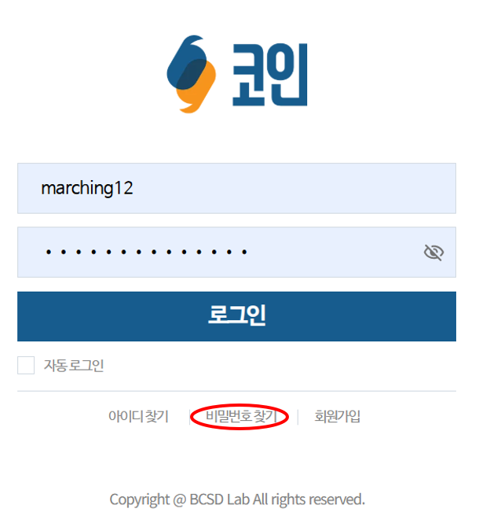
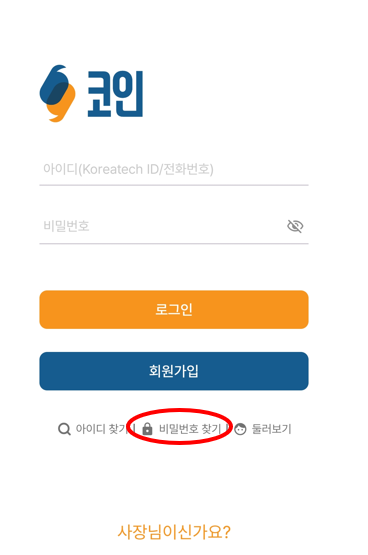
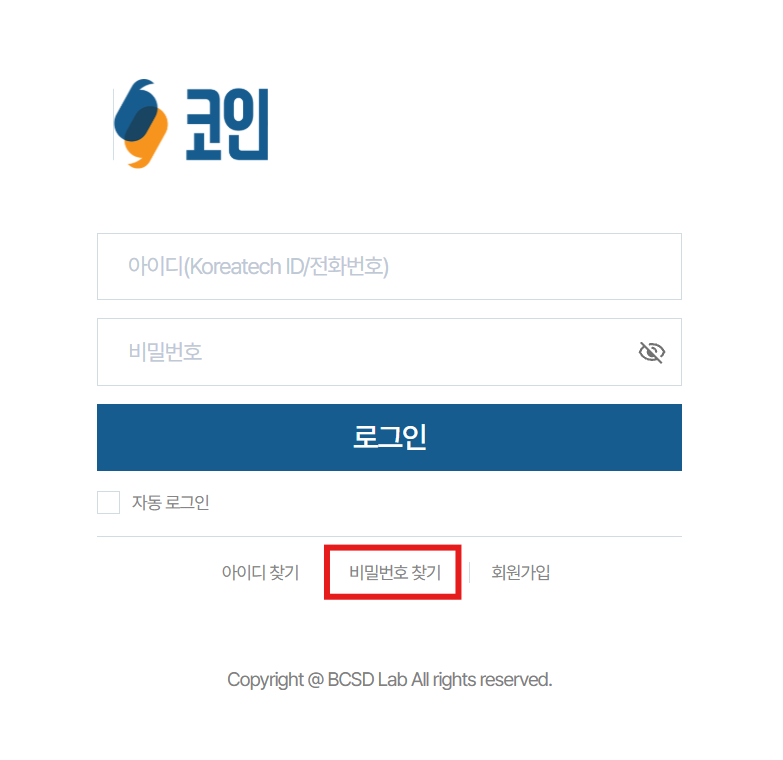
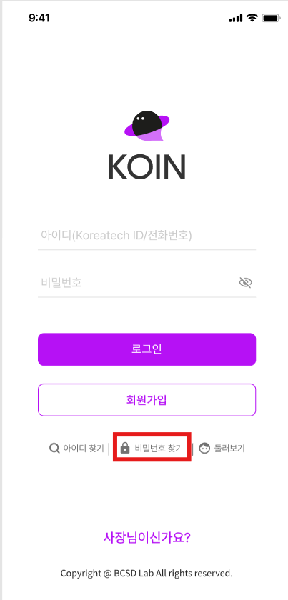

# 2-5 비밀번호찾기(클릭)

원문 페이지 ID: fb10221954bc83229f3f81a666908310

> 원문 스냅샷. 명세 확정·앱 배포·수집 완료를 뜻하지 않습니다.

## 원문 속성

```json
{
  "platform": [
    "ANDROID",
    "IOS",
    "WEB"
  ],
  "url": "source-page-id:fb10221954bc83229f3f81a666908310",
  "구분": "로그인",
  "상태": "로깅 필요",
  "생성일": "2026-11-08T10:51:25.434Z",
  "이벤트 이름": "2-5 비밀번호찾기(클릭)",
  "태그": [
    "로그인"
  ]
}
```

<details>
<summary>이전 로깅</summary>

- event\_label : “login”
- value : “비밀번호 찾기<b>”</b>
- event\_category : “click”

<b>웹</b>




<b>모바일</b>




</details>

<details>
<summary>새 로깅 (26.10.04)</summary>

- 설명: 로그인 화면에서 비밀번호찾기 버튼을 클릭해 해당 경로로 진입할 때 기록한다.
- event\_name: <code>DA2</code>
- screen\_view: <code>login</code>
- event\_label: <code>account__login__account_recovery__password_entry__click</code>
- value: 비밀번호 찾기
- event\_category: <code>click</code>

<details>
<summary>검토사항</summary>

- label 통일 (2026-10-27): <code>account__login__account_recovery__password_entry</code> → <code>account__login__account_recovery__password_entry__click</code>
</details>

<details>
<summary>참고사진 (기능 표시)</summary>

<b>웹</b>



<b>모바일</b>


</details>
</details>
