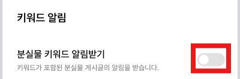
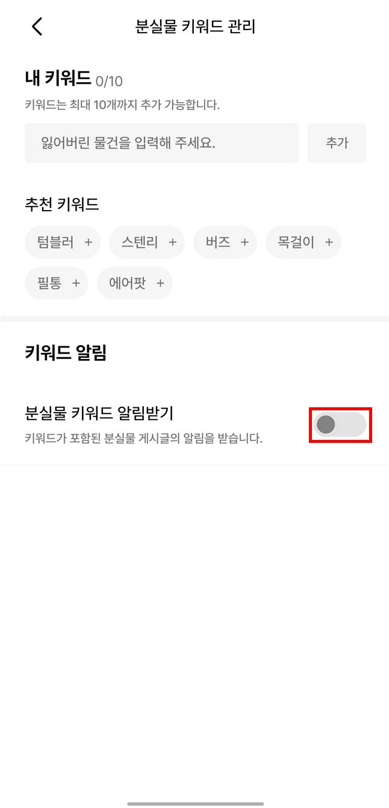

# 12-4. 키워드 알림받기_클릭

원문 페이지 ID: fbd0221954bc82f6844401252b5ad64e

> 원문 스냅샷. 명세 확정·앱 배포·수집 완료를 뜻하지 않습니다.

## 원문 속성

```json
{
  "platform": [
    "ANDROID",
    "IOS"
  ],
  "url": "source-page-id:fbd0221954bc82f6844401252b5ad64e",
  "상태": "로깅 필요",
  "이름": "12-4. 키워드 알림받기\\_클릭",
  "태그": [
    "12. 분실물 키워드"
  ]
}
```

<details>
<summary>이전 로깅</summary>

- 설명: 키워드 알림받기 클릭
- event\_label: “lost\_item\_keyword\_alarm”
- value: “키워드 알림받기”
- event\_category: “click”
- 참고사진


</details>

<details>
<summary>새 로깅 (26.10.12) — 초안</summary>

- 설명: 키워드 알림받기 클릭
- screen\_view: <code>lost_item_keyword_manage</code>
- event\_name: <code>DA2</code>
- event\_label: <code>board__lost_item_keyword_manage__keyword_manage__notification__click</code>
- value: 받기 / 끄기 — 사용자 조작 직후 변경된 상태 기준. 알림을 켜면 받기, 끄면 끄기를 전송한다.
- event\_category: <code>click</code>

<details>
<summary>검토사항</summary>

- 방식 A 반영 (2026-10-28 사용자 확인): 승인된 기존 event\_category <code>click</code>을 복원하고 label 마지막 구간을 일치시켰다. <code>board__lost_item_keyword_manage__keyword_manage__notification__toggle</code> → <code>board__lost_item_keyword_manage__keyword_manage__notification__click</code>. label 끝에 맞춰 category를 바꾼 과거 후속 메모는 이 결정으로 대체한다. 기존 value·event\_name·플랫폼·전송 시점은 유지하며 성공/실패 이벤트를 새로 만들지 않는다.
- 통합 가이드·후속: [로깅 통합 가이드](3c30221954bc8214b1c481c5bbb6fba5.md)
- label 통일 (2026-10-27): <code>board__lost_item_keyword_manage__keyword_manage__notification_toggle</code> → <code>board__lost_item_keyword_manage__keyword_manage__notification__toggle</code> (event\_category는 click 유지, label 끝 toggle과 불일치 — 확인 필요 → 2026-10-27 해소)
- 승인 category 복원 확인 (2026-10-28): 이전 사용자 방식 A 승인에 따라 기존 click을 유지한다. label 끝 단어만 click에 맞추며, category를 select/submit/toggle로 변경하라는 과거 후속 메모는 철회한다.
- 기존 승인 결정 (click 유지, 과거 toggle 변경 지시 철회): 알림 받기·끄기를 value로 구분한다. 사용자 토글 조작 시 변경 후 상태를 한 번 전송하고 화면 최초 진입·초기값 표시만으로 전송하지 않는다. event\_category는 기존 <code>click</code>을 유지한다.
</details>

### 참고사진 (기능 표시)

<columns>
<column ratio="50">
<b>웹</b>

화면 정의에 웹 화면 없음.
</column>
<column ratio="50">
<b>모바일</b>

<details>
<summary>참고사진 · 모바일</summary>

모바일 — 키워드 알림받기 토글


</details>
</column>
</columns>
</details>
