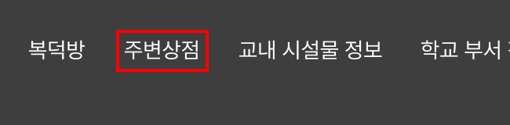

# 1-4 푸터 → 주변상점 (클릭) 

원문 페이지 ID: fcd0221954bc83fea2c801800d9c84bd

> 원문 스냅샷. 명세 확정·앱 배포·수집 완료를 뜻하지 않습니다.

## 원문 속성

```json
{
  "platform": [
    "WEB"
  ],
  "url": "source-page-id:fcd0221954bc83fea2c801800d9c84bd",
  "상태": "완료",
  "생성일": "2026-11-08T10:51:48.970Z",
  "이벤트 이름": "<p>\n1-4 푸터 → 주변상점 (클릭) \n</p>",
  "태그": [
    "1. 메인 -> 카테고리"
  ]
}
```

<details>
<summary>이전 로깅</summary>

<span color="orange">event\_params.key</span>

<ul>
<li>
event\_label : footer
</li>
<li>
value : 주변상점 
</li>
<li>
event\_category : click 
</li>
</ul>
</details>

<details>
<summary>새 로깅 (26.10.17)</summary>

- 설명: 푸터에서 주변 상점 클릭
- screen\_view: <code>footer</code>
- event\_name: <code>DA1</code>
- event\_label: <code>shop__footer__shop_entry__footer_entry__click</code>
- value: 주변상점
- event\_category: <code>click</code>

<details>
<summary>검토사항</summary>

- WEB 이미지 정리 (2026-11-05): Figma 원본의 푸터 주변상점 위치를 다시 캡처하고 코드로 빨간 테두리만 표시했다. 새 WEB 이미지를 먼저 표시하고 구디자인·교체 전 이미지는 접힌 이력 토글로 분리했다. 라벨·value·category·event\_name·screen\_view·플랫폼·모바일 사진은 유지한다.
- screen\_view 확정 (2026-10-30 상민 직접 지시): event\_label의 두 번째 구간과 같은 <code>footer</code> 고정값을 사용한다. 이전 동적 화면명 표기안은 이 결정으로 대체한다. 라벨·category·value·발생 시점·플랫폼·사진은 유지하며 SDK 적용·실제 전송·한 번 전송은 미확인이다.
- 통합 가이드: [로깅 통합 가이드](3c30221954bc8214b1c481c5bbb6fba5.md)
- label DA2 기준 정렬 (2026-10-27): <code>shop__footer__entry__click</code> → <code>shop__footer__shop_entry__footer_entry__click</code>
</details>

### 참고사진 (WEB 리디자인 · 푸터 주변상점)

<b>웹</b>

<details>
<summary>참고사진 · 웹</summary>

[Figma 원본](https://www.figma.com/design/DPlcYuiFxhyT5ULbqec59i/KOIN-Web?node-id=17664-28870) · 2026-11-04. 원본 캡처에 빨간 네모만 추가했다. 빨간 네모는 기존 명세의 주변상점 클릭 위치다. 실제 SDK 적용·배포·전송은 미확인이다.


<details>
<summary>교체 전 리디자인 캡처 (이력)</summary>


</details>

<b>클릭 위치 확대</b>


</details>
</details>


