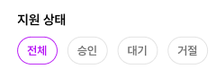
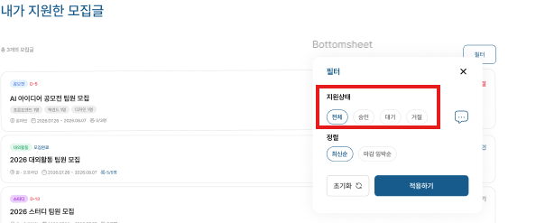
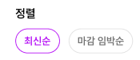
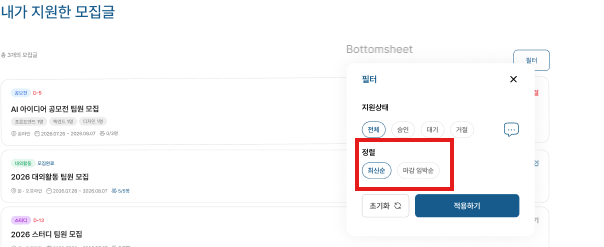
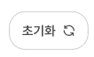
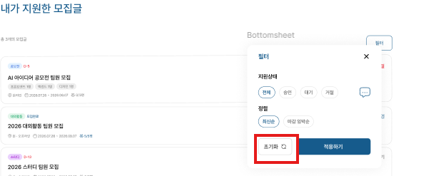
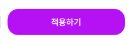
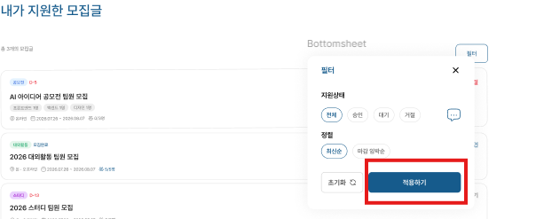
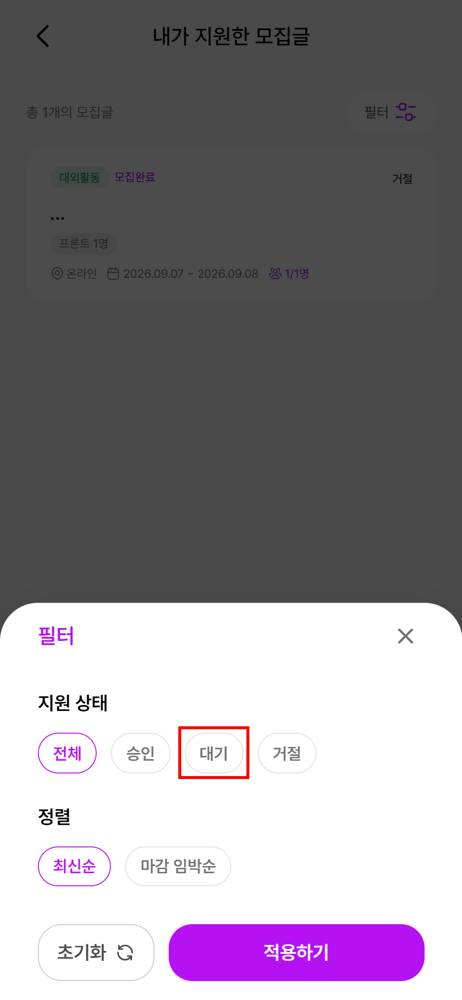
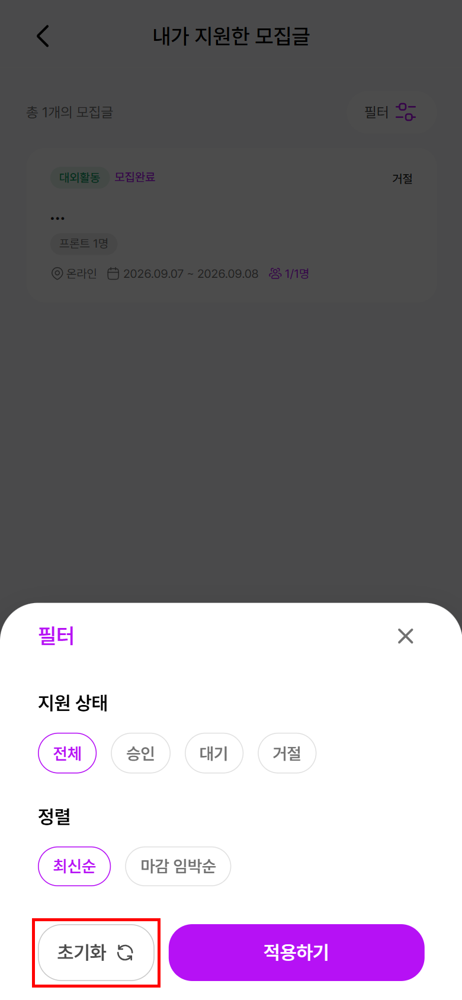

# 8-1. 필터 내부

원문 페이지 ID: fd70221954bc82feb2b10145d93073a1

> 원문 스냅샷. 명세 확정·앱 배포·수집 완료를 뜻하지 않습니다.

## 원문 속성

```json
{
  "platform": [
    "WEB",
    "ANDROID",
    "IOS"
  ],
  "url": "source-page-id:fd70221954bc82feb2b10145d93073a1",
  "구분": "내가 지원한 모집글",
  "상태": "로깅 필요",
  "생성일": "2026-11-08T10:52:14.761Z",
  "이벤트 이름": "8-1. 필터 내부"
}
```


<details>
<summary>이전 로깅</summary>

① 지원 상태 선택

- event\_label : team\_recruitment\_applied\_post\_filter\_status
- value : \{전체 / 승인 / 대기 / 거절\}
- event\_category : click





② 정렬 방식 선택

- event\_label : team\_recruitment\_applied\_post\_filter\_sort
- value : \{최신순 / 마감 임박순\}
- event\_category : click





③ 필터 초기화

- event\_label : team\_recruitment\_applied\_post\_filter\_reset
- value : 초기화
- event\_category : click





④ 필터 적용

- event\_label : team\_recruitment\_applied\_post\_filter\_apply
- value : 적용하기
- event\_category : click




</details>

<details>
<summary>새 로깅 (26.10.17)</summary>

① 지원 상태 선택

- 설명: 내가 지원한 모집글 화면의 필터 팝업에서 지원 상태(전체 / 승인 / 대기 / 거절) 중 하나를 고르는 경우
- screen\_view: <code>team_applied</code>
- event\_name: <code>DA1</code>
- event\_label: <code>team_recruit__team_applied__filter__status__select</code>
- value: \{전체 / 승인 / 대기 / 거절\} (예: 대기)
- event\_category: <code>select</code>

② 정렬 방식 선택

- 설명: 내가 지원한 모집글 화면의 필터 팝업에서 정렬(최신순 / 마감 임박순) 중 하나를 고르는 경우
- screen\_view: <code>team_applied</code>
- event\_name: <code>DA1</code>
- event\_label: <code>team_recruit__team_applied__filter__sort__select</code>
- value: \{최신순 / 마감 임박순\} (예: 최신순)
- event\_category: <code>select</code>

③ 필터 초기화

- 설명: 내가 지원한 모집글 화면의 필터 팝업에서 초기화 버튼을 클릭하는 경우
- screen\_view: <code>team_applied</code>
- event\_name: <code>DA1</code>
- event\_label: <code>team_recruit__team_applied__filter__reset__click</code>
- value: 초기화
- event\_category: <code>click</code>

④ 필터 적용

- 설명: 내가 지원한 모집글 화면의 필터 팝업에서 적용하기를 클릭해 목록을 다시 보여주는 경우
- screen\_view: <code>team_applied</code>
- event\_name: <code>DA1</code>
- event\_label: <code>team_recruit__team_applied__filter__apply__click</code>
- value: 적용하기
- event\_category: <code>click</code>

<details>
<summary>검토사항</summary>

- 통합 가이드·후속: [로깅 통합 가이드](3c30221954bc8214b1c481c5bbb6fba5.md)
- 사진은 stage 로그인 상태 캡처 (①은 필터 팝업을 연 상태). 사진 플랫폼 확인 완료 (이미지 비율 기준: 모바일, 780x1688). 웹 사진 추가 필요
</details>

### 참고사진 (내가 지원한 모집글 필터 내부)

웹 사진은 전 이벤트 없음 (추가 필요).

① 지원 상태 선택

<columns>
<column ratio="50">
<b>웹</b>

<details>
<summary>참고사진 · 웹</summary>

웹 — 사진 없음 (추가 필요)
</details>
</column>
<column ratio="50">
<b>모바일</b>

<details>
<summary>참고사진 · 모바일</summary>

모바일 — 지원 상태 선택 (출처: stage 실제 캡처, 빨간 네모 = 클릭 위치)


</details>
</column>
</columns>

② 정렬 방식 선택

<columns>
<column ratio="50">
<b>웹</b>

<details>
<summary>참고사진 · 웹</summary>

웹 — 사진 없음 (추가 필요)
</details>
</column>
<column ratio="50">
<b>모바일</b>

<details>
<summary>참고사진 · 모바일</summary>

모바일 — 정렬 방식 선택 (출처: stage 실제 캡처, 빨간 네모 = 클릭 위치)


</details>
</column>
</columns>

③ 필터 초기화

<columns>
<column ratio="50">
<b>웹</b>

<details>
<summary>참고사진 · 웹</summary>

웹 — 사진 없음 (추가 필요)
</details>
</column>
<column ratio="50">
<b>모바일</b>

<details>
<summary>참고사진 · 모바일</summary>

모바일 — 필터 초기화 (출처: stage 실제 캡처, 빨간 네모 = 클릭 위치)


</details>
</column>
</columns>

④ 필터 적용

<columns>
<column ratio="50">
<b>웹</b>

<details>
<summary>참고사진 · 웹</summary>

웹 — 사진 없음 (추가 필요)
</details>
</column>
<column ratio="50">
<b>모바일</b>

<details>
<summary>참고사진 · 모바일</summary>

모바일 — 필터 적용 (출처: stage 실제 캡처, 빨간 네모 = 클릭 위치)


</details>
</column>
</columns>
</details>
