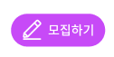
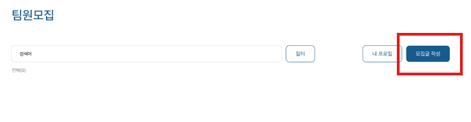
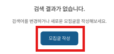
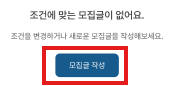
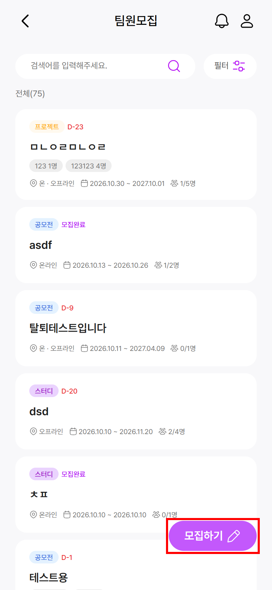

# 5. 모집하기 클릭

원문 페이지 ID: fd70221954bc83e7a82e01708d828e4d

> 원문 스냅샷. 명세 확정·앱 배포·수집 완료를 뜻하지 않습니다.

## 원문 속성

```json
{
  "platform": [
    "WEB",
    "ANDROID",
    "IOS"
  ],
  "url": "source-page-id:fd70221954bc83e7a82e01708d828e4d",
  "구분": "모집글 작성하기",
  "상태": "로깅 필요",
  "생성일": "2026-11-12T05:08:10.877Z",
  "이벤트 이름": "5\\. 모집하기 클릭"
}
```

<details>
<summary>과거 로깅</summary>

- event\_label : team\_recruitment\_recruit
- value : 모집하기
- event\_category : “click”











</details>

<details>
<summary>새 로깅</summary>

- 설명: 팀원 모집 목록 화면에서 모집하기(mobile 플로팅 버튼) / 모집글 작성(web) 버튼을 클릭해 모집글 작성 화면으로 들어가는 경우 (비로그인이면 로그인 화면으로 이동)
- screen\_view: <code>team_list</code>
- event\_name: <code>DA1</code>
- event\_label: <code>team_recruit__team_list__team_write__entry__click</code>
- value: 모집하기
- event\_category: <code>click</code>

### 참고사진 (모집하기 클릭)

<columns>
<column ratio="50">
<b>웹</b>

<b>참고사진 · 웹</b>

웹 — 사진 없음 (추가 필요)
</column>
<column ratio="50">
<b>모바일</b>

<b>참고사진 · 모바일</b>

모바일 — 모집하기 클릭 (출처: stage 실제 캡처, 빨간 네모 = 클릭 위치)


</column>
</columns>
</details>
