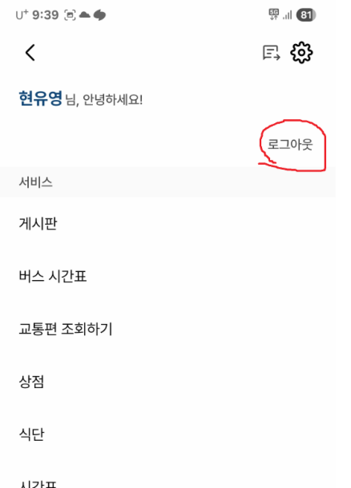
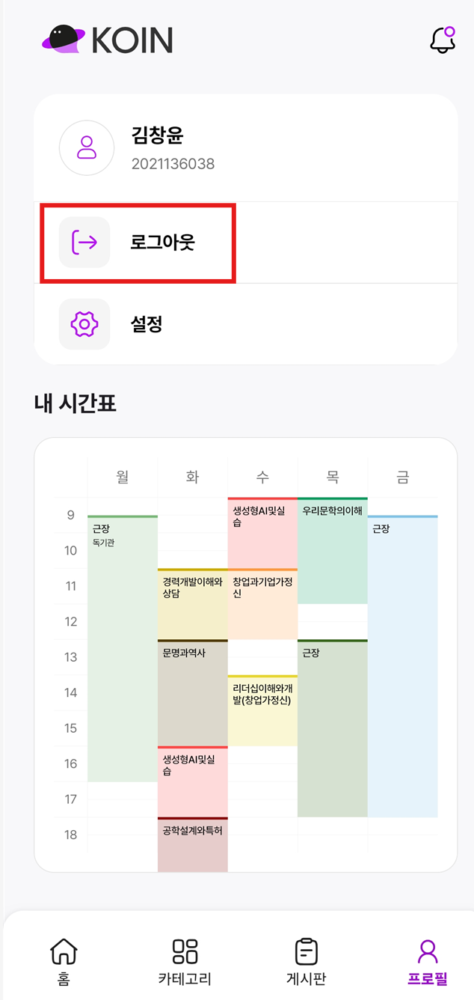

# [레거시] 4-2 로그아웃(클릭)

원문 페이지 ID: fe30221954bc83949b21014f94991fc3

> 원문 스냅샷. 명세 확정·앱 배포·수집 완료를 뜻하지 않습니다.

## 원문 속성

```json
{
  "platform": [
    "ANDROID",
    "IOS"
  ],
  "url": "source-page-id:fe30221954bc83949b21014f94991fc3",
  "구분": "로그아웃",
  "상태": "레거시",
  "생성일": "2026-11-08T10:51:29.860Z",
  "이벤트 이름": "\\[레거시\\] 4-2 로그아웃(클릭)",
  "태그": [
    "로그아웃"
  ]
}
```

<callout icon="📁" color="gray_bg">
<b>레거시 보존 · 현행 기준은 홈화면 리디자인</b>

- 2026-11-05 사용자 지시: 홈화면 리디자인의 로깅은 모두 유지하고, 겹치는 다른 서비스 명세를 레거시로 보존한다.
- 프로필 로그아웃의 현행 기준: [4-3 로그아웃 클릭](d6b0221954bc820288550143b7dce11e.md).
- 이 페이지는 별도 신규 구현·추가 전송 대상이 아니다. 아래 라벨·value·category·event\_name·screen\_view·사진·플랫폼과 이전 로깅은 이력으로 보존한다.
- 이전의 ‘이 페이지가 대표’·‘두 문서 별개 유지’·‘같은 라벨 문서 계약’ 설명은 이 최신 결정으로 대체한다. 홈 명세의 라벨·값·필드는 이번 작업에서 변경하지 않는다.
- 실제 SDK의 옛 라벨 중단·전환·단일 전송은 미확인이다. 이 문서 정리는 운영 코드나 데이터의 삭제·변경을 뜻하지 않는다.
</callout>

<details>
<summary>이전 로깅</summary>

- event\_label : “hamburger”
- value : “로그아웃<b>”</b>
- event\_category : “click”



</details>

<details>
<summary>이관 전 새 로깅 (26.10.04) — 레거시 보존</summary>

- 설명: 프로필 화면의 로그아웃 버튼을 클릭할 때 기록한다. 로그아웃 처리 성공 이벤트를 새로 만들지 않는다.
- event\_name: <code>DA2</code>
- screen\_view: <code>main_profile</code>
- event\_label: <code>account__main_profile__logout__click</code>
- value: 로그아웃
- event\_category: <code>click</code>

<details>
<summary>검토사항</summary>

- 코드·수집 대조 (2026-11-01): [Android 프로필 호출](https://github.com/BCSDLab/KOIN_ANDROID/blob/ee67a50f554030a76cfb7d8948b89d8efc806e9d/feature/profile/src/main/java/in/koreatech/koin/feature/profile/ProfileScreen.kt#L74-L81)과 [iOS 프로필 호출](https://github.com/BCSDLab/KOIN_iOS/blob/ea494b30ffa6197d62592369f7ae4265ced2e678/Koin/Presentation/Home/Profile/ProfileView.swift#L45-L53)은 로그아웃 클릭과 value 로그아웃을 확인한다. 확인한 커밋의 label은 home\_logout, 이벤트명은 CAMPUS로 새 DA2 계약과 다르다. 10/25\~31 raw GA4에서 home\_logout은 Android 1건, 새 label은 0건이다. iOS 미관측은 기능 부재 증거가 아니다. 새 label·고정 screen\_view·DA2의 SDK 반영 및 실제 한 번 전송은 검증 대기다.
- 동일 이벤트 문서 계약 (2026-11-01): 기준 명세는 [[레거시] 4-2 로그아웃(클릭)](fe30221954bc83949b21014f94991fc3.md), 대응 명세는 [4-3 로그아웃 클릭](d6b0221954bc820288550143b7dce11e.md)다. 프로필 로그아웃 두 문서는 하나의 사용자 클릭을 설명하므로 문서 수만큼 추가·중복 전송하지 않는다. 기존 label·screen\_view·event\_name·value·category·플랫폼은 유지한다. 실제 호출 지점·SDK 전송값·플랫폼별 적용·한 번 전송은 미확인이다.
- 발생 시점: 프로필 화면의 로그아웃 버튼 클릭. 로그아웃 처리 성공 이벤트를 추가하는 변경이 아니다.
</details>

<details>
<summary>참고사진 · 모바일</summary>

<b>모바일</b>


</details>
</details>
