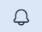
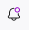

# 1-1 알림 클릭

원문 페이지 ID: fee0221954bc83a49f7c0170fceecf9e

> 원문 스냅샷. 명세 확정·앱 배포·수집 완료를 뜻하지 않습니다.

## 원문 속성

```json
{
  "platform": [
    "ANDROID",
    "IOS"
  ],
  "url": "source-page-id:fee0221954bc83a49f7c0170fceecf9e",
  "구분": "홈화면",
  "상태": "완료",
  "생성일": "2026-11-12T05:08:00.323Z",
  "이벤트 이름": "1-1 알림 클릭"
}
```

<details>
<summary>과거 로깅</summary>

- event\_label : notification
- value : 알림 아이콘
- event\_category : click






</details>

<details>
<summary>새 로깅</summary>

<b>알림 아이콘</b>

- 설명: 메인 화면의 알림 아이콘을 눌러 공용 알림 목록으로 들어갈 때 클릭 1회를 기록한다.
- screen\_view: <code>main</code>
- event\_name: <code>DA2</code>
- event\_label: <code>main__main__notification_list__entry__click</code>
- value: 알림 아이콘
- event\_category: <code>click</code>
</details>
