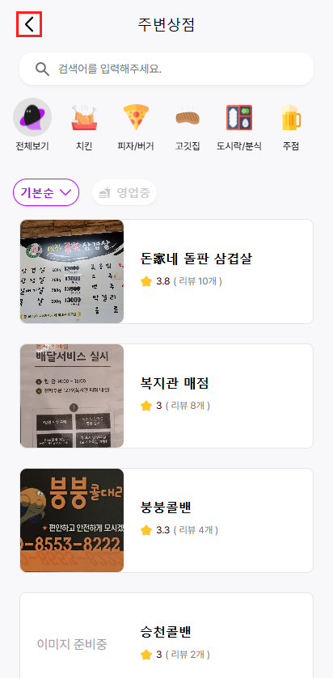

# 2-23 상점 목록 뒤로가기 (Click · Swipe)

원문 페이지 ID: ff80221954bc83ae983c01e2a49554a9

> 원문 스냅샷. 명세 확정·앱 배포·수집 완료를 뜻하지 않습니다.

## 원문 속성

```json
{
  "platform": [
    "IOS",
    "ANDROID"
  ],
  "url": "source-page-id:ff80221954bc83ae983c01e2a49554a9",
  "상태": "로깅 필요",
  "생성일": "2026-11-12T05:07:35.825Z",
  "이벤트 이름": "2-23 상점 목록 뒤로가기 (Click · Swipe)",
  "태그": [
    "2. 상점 카테고리"
  ]
}
```

<details>
<summary>과거 로깅</summary>

- event\_label: <code>shop_categories_back</code>
- value: 기존 명세 미기재
- event\_category: click / swipe
</details>

<details>
<summary>새 로깅</summary>

### 뒤로가기 버튼

- 설명: 상점 목록에서 뒤로가기 버튼 또는 뒤로가기 스와이프로 이전 화면으로 돌아가는 전환이 완료되었을 때 기록한다. 취소된 스와이프와 하단 홈 탭 클릭은 포함하지 않는다.
- screen\_view: <code>shop_list</code>
- event\_name: <code>DA1</code>
- event\_label: <code>shop__shop_list__navigation__back__click</code>
- value: 메인
- event\_category: <code>click</code>

### 뒤로가기 스와이프

- 설명: 상점 목록에서 뒤로가기 버튼 또는 뒤로가기 스와이프로 이전 화면으로 돌아가는 전환이 완료되었을 때 기록한다. 취소된 스와이프와 하단 홈 탭 클릭은 포함하지 않는다.
- screen\_view: <code>shop_list</code>
- event\_name: <code>DA1</code>
- event\_label: <code>shop__shop_list__navigation__back__swipe</code>
- value: 메인
- event\_category: <code>swipe</code>

### 참고사진

<columns>
<column ratio="50">
<b>웹</b>

PC 웹: 상점 목록에 대응하는 뒤로가기 버튼 없음.
</column>
<column ratio="50">
<b>모바일</b>





Stage 모바일 웹 · 상점 목록 뒤로가기 버튼

</column>
</columns>
</details>
