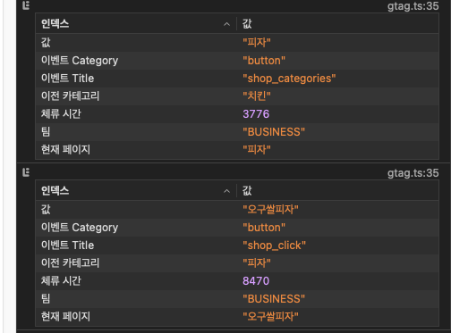

# 해결 (1)

[← 주변상점 로깅 목록](../../../../../../../event-log/01-%EC%A3%BC%EB%B3%80%EC%83%81%EC%A0%90/README.md)

원문에 과거·새 로깅 구분이 없어 아래 정의와 참고사진을 원문 순서로 표시합니다.

원문 미기재 항목: `event_name`, `event_label`, `screen_view`, `value`, `event_category`. 값을 추정하지 않았습니다.

웹: 

<ol>

- 카테고리 이동 후 상점을 클릭하면 체류 시간이 중첩되어 적힙니다. 

</ol>

→ 카테고리 이동을 하면 타이머를 리셋하고 상점으로 들어가는 시간을 체크 해주시면 되겠습니다. 

---

안드로이드 

상점에서 나갔다가 다시 들어와도 시간이 중복되는 이슈 

---

원문 정보

원본 ID: `0b60221954bc836090aa01291cb2a9ab`  
[보존 원문](../../../../../../original/notion/pages/0b60221954bc836090aa01291cb2a9ab.md)

