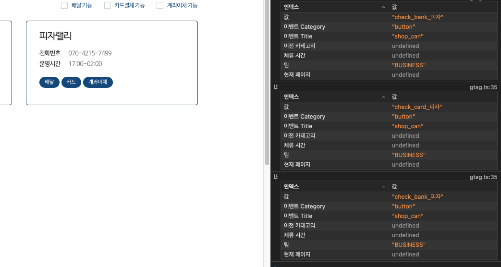
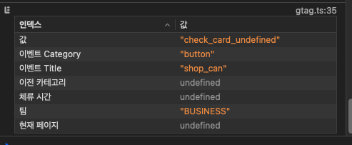

# 해결 (1)

[← 주변상점 로깅 목록](../../../../../../../event-log/01-%EC%A3%BC%EB%B3%80%EC%83%81%EC%A0%90/README.md)

원문에 과거·새 로깅 구분이 없어 아래 정의와 참고사진을 원문 순서로 표시합니다.

원문 미기재 항목: `event_name`, `event_label`, `screen_view`, `value`, `event_category`. 값을 추정하지 않았습니다.

웹 

<ol>

- 체크 표시를 풀때 이벤트가 발생 

</ol>

→ 토글을 누를때 바로 이벤트가 생성되게 해주시면 되겠습니다. 

추가로 토글을 해제할때는 이벤트가 생성 되지 않아도 됩니다. 

<ol start="2">

- 헤더나 푸터를 통해 들어올때 이슈 발생 

</ol>

→ 전체보기 값으로 들어오면 될거 같습니다! 

<ol start="3">

- 반응형 웹 이슈 

</ol>

반응형 웹에서는 토글 자체를 이벤트를 측정하지 못하고 있습니다. 

추가해주시면 감사하겠습니다! → 신규 이벤트로 넣어주시면 되겠습니다!

---

원문 정보

원본 ID: `8700221954bc827cabe281c196352cbc`  
[보존 원문](../../../../../../original/notion/pages/8700221954bc827cabe281c196352cbc.md)

