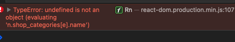

# [레거시] 해결 (1)

> **레거시 문서** · 과거 구현과 로깅을 확인하기 위한 보존 자료입니다.

[← 미래의 주변상점 - 레거시 로깅 목록](../../../../../../../event-log/05-%EB%AF%B8%EB%9E%98%EC%9D%98-%EC%A3%BC%EB%B3%80%EC%83%81%EC%A0%90-%EB%A0%88%EA%B1%B0%EC%8B%9C/README.md)

원문에 과거·새 로깅 구분이 없어 아래 정의와 참고사진을 원문 순서로 표시합니다.

원문 미기재 항목: `event_name`, `event_label`, `screen_view`, `value`, `event_category`. 값을 추정하지 않았습니다.

웹: 

<ol>

- 헤더나 푸터를 이용하여 주변상점을 들어온뒤 검색 버튼을 누르면 에러가 남. 

</ol>

→ 전체 보기값 을  넣어서 처리해주시면 될 거 같습니다. 

---

원문 정보

원본 ID: `5980221954bc82bdae6d018a6ffdccc7`  
[보존 원문](../../../../../../original/notion/pages/5980221954bc82bdae6d018a6ffdccc7.md)

